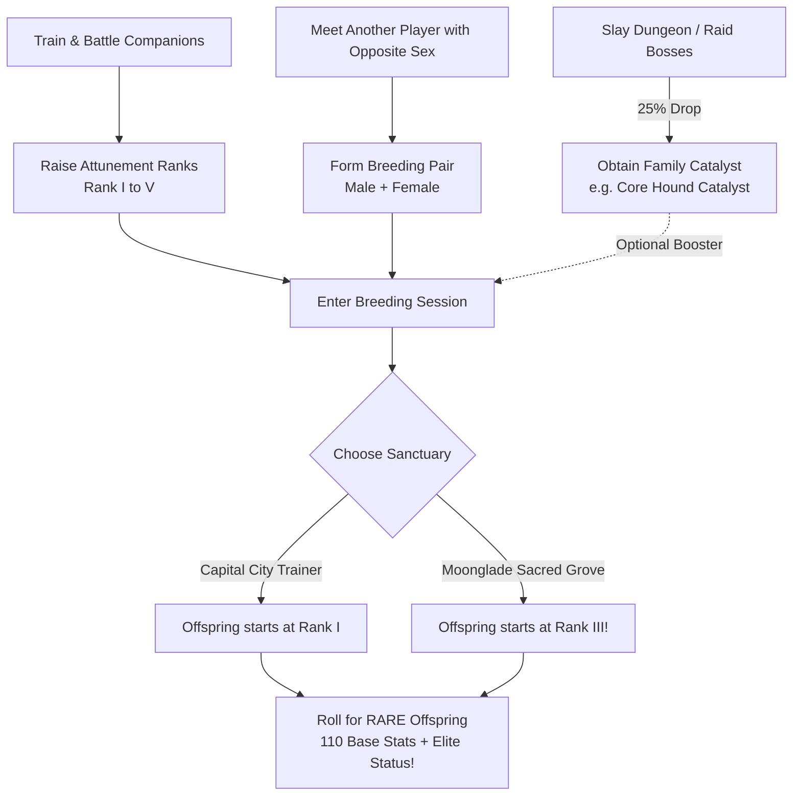

# Forever Safari: Co-Op Breeding System, Genetics & Catalyst Architecture

## 1. Executive Summary & Progression Game Loop
The breeding system in *Forever Safari* is designed around **forced social cooperation**, **progression investment**, and the pursuit of **Rare** companion variants:



---

## 2. Biological Sexing, Pre-Capture Stalking & Construct Matrix Re-forging

To support organic field hunting and co-op social collaboration:

### A. Deterministic Wild Anatomy & Pre-Capture Scouting
* Every wild creature in Azeroth possesses a deterministic biological designation derived from its unique world entity ID (`UnitGUID`):
  - **Genderless Constructs**: `Mechanical` and `Elemental` species are categorized as `Genderless` (`⚙`).
  - **Biological Organisms**: Determined by the ASCII character sum of the creature's `UnitGUID`:
    $$\text{Sex} = \begin{cases} \text{Sire (♂)} & \text{if } \sum \text{byte}(c) \pmod 2 = 1 \\ \text{Dam (♀)} & \text{if } \sum \text{byte}(c) \pmod 2 = 0 \end{cases}$$
* **Field Scouting HUD**: When targeting any wild creature, the Observation HUD (`CaptureHUD`) displays its anatomy:
  - `[ ❓ Sex: Unknown ]` before field study.
  - `[ ♀ Dam ]`, `[ ♂ Sire ]`, or `[ ⚙ Genderless ]` once observed or captured.
* This guarantees that a creature's biological sex remains 100% consistent from field stalking, channeled observation, and turn-based battle through capture and vault banking.

### B. Genderless Construct Matrix Re-forging
* Mechanicals and Elementals lack biological sex (`anatomy = "Genderless"`).
* In the **Cenarion Nursery (`/fs nursery`)**, two matching Genderless constructs can re-forge an artificial matrix when paired with a **slotted Family Catalyst** (e.g. *[Gnomeregan Gyro-Core]* or *[Molten Core Catalyst]*).
* Matrix re-forging yields a new high-pedigree construct offspring carrying purebred IV stat inheritances.

### C. Cryptographic HMAC Signing
* In [Core/Crypto.lua](file:///home/primustech/.steam/debian-installation/steamapps/compatdata/4226358677/pfx/drive_c/Program%20Files%20%28x86%29/World%20of%20Warcraft/_classic_beta_/Interface/AddOns/ForeverSafari/Core/Crypto.lua), the companion's biological anatomy (`Sire`, `Dam`, or `Genderless`) is signed into the serialization envelope (`Crypto:SignMob(mob)`), preventing local tampering or desync.
* Renders distinct visual badges across the Safari Journal, Grid View, and Inspector:
  - `|cff66ccff♂ Male (Sire)|r` (Cyan / Blue)
  - `|cffff99cc♀ Female (Dam)|r` (Pink / Magenta)
  - `|cffa0a0a0⚙ Genderless|r` (Silver / Chrome)

---

## 3. The Highlander Rule (Unique Ownership)

* A player character can own **only one active instance of each creature species** at any time.
* Eliminates box hoarding and keeps kennel management clean and strategic.
* If a player hatches a new offspring of a species they already own, they must decide whether to keep the newborn (releasing or storing the existing parent) or trade/gift the egg.

---

## 4. Forced Co-Op Social Handshake Protocol

Breeding is executed exclusively through peer-to-peer player interaction anchored at an NPC breeder:

```
[Player A: Sire Owner]                      [Player B: Dam Owner]
          │                                           │
          ├────────────── Target Each Other ──────────┤
          │                                           │
          ├─────── Initiate P2P Handshake ───────────┤
          │       (ForeverSafariComm Protocol)        │
          │                                           │
          ├── Place Male Companion ───┐               │
          │                           │               │
          │               ┌─── Place Female Companion ┤
          │               │                           │
          ├── Slot Catalyst (Optional)                │
          │                                           │
          ├───────── Dual-Accept Confirmation ────────┤
          │                                           │
          ▼                                           ▼
     [ Both Players Lock In & Breeding Ritual Executes ]
```

### P2P Handshake Messages in `Core/Comms.lua`
1. `NURSERY_INVITE`: Initiates co-op breeding session with targeted player.
2. `NURSERY_OFFER`: Transmits signed pet payload and slotted Catalyst to partner.
3. `NURSERY_LOCK`: Confirms companion placement and displays partner's companion.
4. `NURSERY_EXECUTE`: Triggered when both players press "Perform Ritual".
5. `NURSERY_CANCEL`: Cleans up state and closes interface if either player disconnects or cancels.

---

## 5. Tiered Breeding Grounds & Attunement Outcomes

Breeding is accessible early in the game journey, with location determining the newborn's baseline Attunement:

| Breeding Sanctuary | Location & NPC Anchors | Availability | Offspring Starting Rank | Progression Advantage |
| :--- | :--- | :---: | :---: | :--- |
| **Capital City Pet Trainers** | Stormwind, Orgrimmar, Ironforge, Thunder Bluff, Darnassus, Undercity | **Early Game** (Accessible immediately) | **Attunement Rank I** *(Untamed)* | Standard baseline. Offspring must be trained and leveled from scratch. |
| **Moonglade Sacred Grove** | Nighthaven, Moonglade *(Cenarion Master Breeders)* | **Sacred Sanctuary** (Unlocked earlier, requires journey) | **Attunement Rank III** *(Attuned)* | **The Premium Outcome**: Skips early grind! Offspring is instantly battle-tested with higher stat multipliers and 0% disobedience. |

### NPC Gossip Hook
* On `GOSSIP_SHOW`, detect whether the targeted NPC is a Capital City Pet Trainer or a Moonglade Cenarion Breeder.
* Injects gossip option: `|cffffd100[Forever Safari] Open Breeding Chamber|r` to launch `UI/NurseryFrame.lua`.

---

## 6. The Rare Breeding Formula & Catalyst Doubler

### Why Players Breed
Breeding provides the exclusive path to elevate common bloodlines into **Rare Companions**, granting:
* **110 Base Stat Budget** (vs. 100 Base for normal companions).
* Enhanced stat multipliers.
* Rare decorative border in the Safari Journal and battle HUD.

### The Mathematical Formula

$$\mathbf{\text{Rare Chance \%} = (\text{Male Attunement Rank} + \text{Female Attunement Rank}) \times \text{Catalyst Multiplier}}$$

* **$\text{Catalyst Multiplier}$**:
  * **$1.0\times$** without Catalyst.
  * **$2.0\times$** with Catalyst (**Doubled!**).

### Probability Matrix

| Male Attunement | Female Attunement | Combined Base Sum | Normal Odds (No Catalyst) | Boosted Odds (**With Catalyst**) |
| :---: | :---: | :---: | :---: | :---: |
| **Rank I** (1) | **Rank I** (1) | 2 | **2%** | **4%** |
| **Rank II** (2) | **Rank I** (1) | 3 | **3%** | **6%** |
| **Rank II** (2) | **Rank II** (2) | 4 | **4%** | **8%** |
| **Rank III** (3) | **Rank II** (2) | 5 | **5%** | **10%** |
| **Rank III** (3) | **Rank III** (3) | 6 | **6%** | **12%** |
| **Rank IV** (4) | **Rank III** (3) | 7 | **7%** | **14%** |
| **Rank IV** (4) | **Rank IV** (4) | 8 | **8%** | **16%** |
| **Rank V** (5) | **Rank IV** (4) | 9 | **9%** | **18%** |
| **Rank V** (5) | **Rank V** (5) | 10 | **10%** | **20%** |

---

## 7. Boss Catalysts & Economy Integration

* Dungeon and raid bosses drop **Catalyst Shards** matching their subfamily/family at a **25% drop rate**:
  * **Magmadar** $\to$ *Core Hound Catalyst*
  * **Gahz'rilla** $\to$ *Hydra Catalyst*
  * **Princess Huhuran** $\to$ *Silithid Catalyst*
  * **Maexxna** $\to$ *Spider Catalyst*
  * **Onyxia** $\to$ *Dragonkin Catalyst*
  * **Ragnaros** $\to$ *Elemental Catalyst*
* Catalysts are consumed in the breeding chamber to activate the **$2\times$ Rare Chance Doubler**.

---

---

## 8. Egg Tiers, Yields & Highlander Dynamics

Under the **Highlander Unique Ownership Rule** (maximum 1 active instance per species per player), multiple eggs create high-stakes rarity decisions and an active social economy.

### A. The Two Egg Tiers

| Feature | 🥚 Normal Safari Egg (`safari_egg_<family>`) | 🔮 Catalyzed Safari Egg (`safari_egg_<family>_catalyzed`) |
| :--- | :--- | :--- |
| **Creation** | Bred without a catalyst | Infused with a Boss Catalyst (*Core Hound, Hydra, etc.*) |
| **Rare Probability** | $(\text{Male Rank} + \text{Female Rank})\%$ (**2% – 10%**) | **Doubled Odds**: $(\text{Male Rank} + \text{Female Rank}) \times 2\%$ (**4% – 20%**) |
| **Item Quality** | Rare (Blue, `|cff0070dd|r`) | Epic (Purple, `|cffa335ee|r`) |
| **Visual Icon** | `Interface\Icons\INV_Egg_02` | `Interface\Icons\INV_Egg_03` (Prismatic / Glowing) |
| **Tooltip** | *"A warm, pulsing egg produced from companion breeding."* | *"Infused with raw metamorphic catalyst energy! Has a doubled chance to hatch into a Rare champion."* |

---

### B. Egg Yield Mechanics

The presence of a Catalyst directly increases egg litter volume:

1. **Standard Uncatalyzed Breeding**:
   * **1 Normal Egg per Player** guaranteed (2 eggs total).
   * **Bonus 3rd Egg (20% Chance)**: A 20% roll awards a bonus 3rd Normal Egg, resolved via automated $d100$ tie-breaker between the two players.
2. **Catalyzed Breeding (Catalyst Consumed)**:
   * **2 Catalyzed Eggs per Player Guaranteed** (4 eggs total across the pair)!
   * Both players receive **two independent shots** at hatching a Rare champion with the doubled $4\% - 20\%$ probability.

---

### C. Highlander Rarity Decisions & Trading Value
* If an egg hatches into a **Normal** (100 base budget) and the second egg hatches into a **Rare** (110 base budget), the player upgrades their squad to the Rare.
* Duplicate eggs or unhatched species can be traded or gifted to friends, guildmates, or collection partners, driving an active player-to-player trade economy.
* Eggs are stored and gestated within the player's Virtual Safari Bag (`/fsbag`). Incubation progresses through field battles and quests, unlocking right-click "Hatch" when fully gestated.
