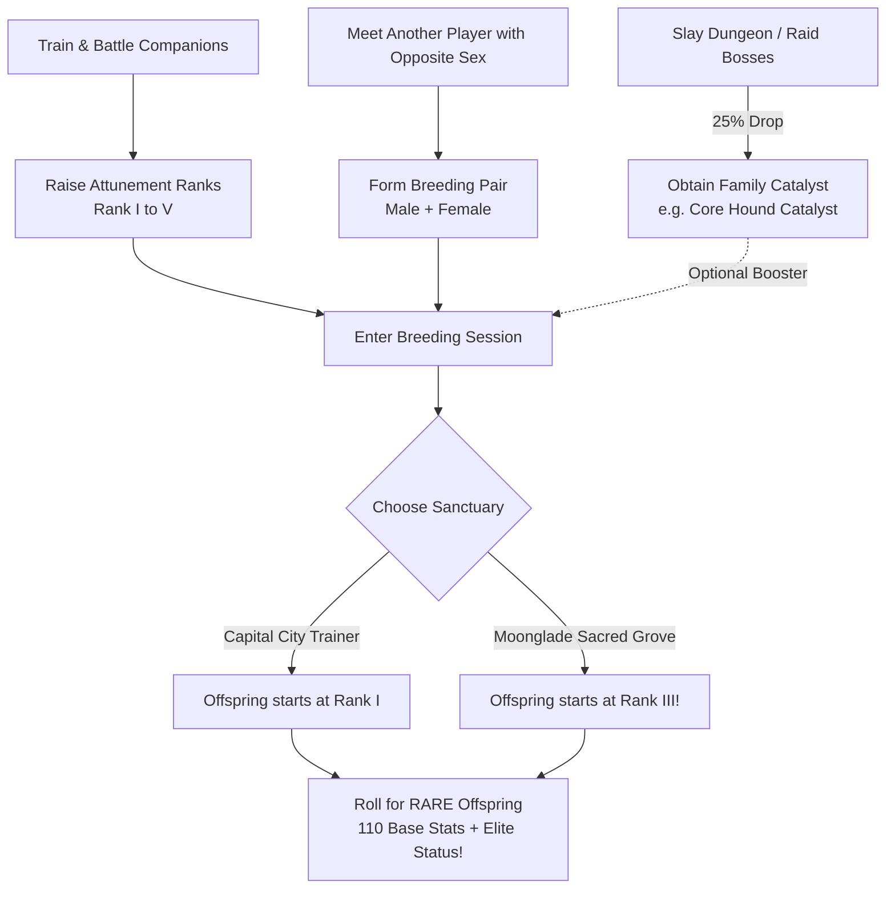

# Forever Safari: Co-Op Breeding System, Genetics & Catalyst Spec

## 1. Executive Summary & Core Game Loop
The breeding system in *Forever Safari* is designed around **forced social cooperation**, **progression investment**, and the pursuit of **Rare** companion variants:



---

## 2. Biological Sex & Single-Sex Generation (The Asymmetry Rule)

To prevent solitary alt-farming and guarantee social collaboration:

### A. The 50/50 Player Seed
* Every creature in the game has a biological sex: **Male (♂)** or **Female (♀)**.
* When a player character first encounters, captures, or unboxes a specific creature species (e.g. *Stonetusk Boar*), the game rolls a persistent **50/50 seed**:
  - The species is permanently designated as either **Male** or **Female** for that player character.
* **Result**: Every copy of that species this character ever encounters or owns will always be of that same sex.

### B. Self-Breeding Impossibility
* Because a player can only access one sex per species, **a player can never breed with themselves**.
* Solo alt-breeding is strictly blocked. Breeding always requires another player.

---

## 3. The Highlander Rule (Unique Ownership)

* A player character can own **only one active instance of each creature species** at any time.
* Eliminates box hoarding and keeps kennel management clean and strategic.
* If a player hatches a new offspring of a species they already own, they must decide whether to keep the newborn (releasing or storing the existing parent) or trade/gift the egg.

---

## 4. Forced Co-Op Social Handshake

Breeding is executed exclusively through peer-to-peer player interaction:

```
[Player A: Sire Owner]                      [Player B: Dam Owner]
          │                                           │
          ├────────────── Target Each Other ──────────┤
          │                                           │
          ├─────── Initiate P2P Handshake ───────────┤
          │       (ForeverSafariComm Protocol)        │
          │                                           │
          ├── Place Male Companion ───┐               │
          │                           │               │
          │               ┌─── Place Female Companion ┤
          │               │                           │
          ├───────── Dual-Accept Confirmation ────────┤
          │                                           │
          ▼                                           ▼
     [ Both Players Lock In & Breeding Process Executes ]
```

---

## 5. Tiered Breeding Grounds & Attunement Outcomes

Breeding is available early in the player journey, with location determining the newborn's baseline Attunement:

| Breeding Sanctuary | Location & NPCs | Availability | Offspring Starting Rank | Progression Advantage |
| :--- | :--- | :---: | :---: | :--- |
| **Capital City Pet Trainers** | Stormwind, Orgrimmar, Ironforge, Thunder Bluff, Darnassus, Undercity | **Early Game** (Accessible immediately) | **Attunement Rank I** *(Untamed)* | Standard baseline. Offspring must be trained and leveled from scratch. |
| **Moonglade Sacred Grove** | Nighthaven, Moonglade *(Cenarion Master Breeders)* | **Sacred Sanctuary** (Unlocked earlier, requires journey) | **Attunement Rank III** *(Attuned)* | **The Premium Outcome**: Skips early grind! Offspring is instantly battle-tested with higher stat multipliers and 0% disobedience. |

---

## 6. The Rare Breeding Formula & Catalyst Doubler

### Why Players Breed
Breeding provides the exclusive path to elevate common bloodlines into **Rare Companions**, granting:
* **110 Base Stat Budget** (vs. 100 Base for normal companions).
* Enhanced stat multipliers.
* Rare decorative border in the Safari Journal and battle HUD.

### The Mathematical Formula

$$\mathbf{\text{Rare Chance \%} = (\text{Male Attunement Rank} + \text{Female Attunement Rank}) \times \text{Catalyst Multiplier}}$$

* **$\text{Catalyst Multiplier}$**:
  * **$1.0\times$** without Catalyst.
  * **$2.0\times$** with Catalyst (**Doubled!**).

### Probability Matrix

| Male Attunement | Female Attunement | Combined Base Sum | Normal Odds (No Catalyst) | Boosted Odds (**With Catalyst**) |
| :---: | :---: | :---: | :---: | :---: |
| **Rank I** (1) | **Rank I** (1) | 2 | **2%** | **4%** |
| **Rank II** (2) | **Rank I** (1) | 3 | **3%** | **6%** |
| **Rank II** (2) | **Rank II** (2) | 4 | **4%** | **8%** |
| **Rank III** (3) | **Rank II** (2) | 5 | **5%** | **10%** |
| **Rank III** (3) | **Rank III** (3) | 6 | **6%** | **12%** |
| **Rank IV** (4) | **Rank III** (3) | 7 | **7%** | **14%** |
| **Rank IV** (4) | **Rank IV** (4) | 8 | **8%** | **16%** |
| **Rank V** (5) | **Rank IV** (4) | 9 | **9%** | **18%** |
| **Rank V** (5) | **Rank V** (5) | 10 | **10%** | **20%** |

---

## 7. Boss Catalysts & Economy Integration

* Dungeon and raid bosses drop **Catalyst Shards** matching their subfamily/family at a **25% drop rate**:
  * **Magmadar** $\to$ *Core Hound Catalyst*
  * **Gahz'rilla** $\to$ *Hydra Catalyst*
  * **Princess Huhuran** $\to$ *Silithid Catalyst*
  * **Maexxna** $\to$ *Spider Catalyst*
  * **Onyxia** $\to$ *Dragonkin Catalyst*
  * **Ragnaros** $\to$ *Elemental Catalyst*
* Catalysts are consumed in the breeding chamber to activate the **$2\times$ Rare Chance Doubler**.

---

## 8. Egg Distribution & Fair Split

When the breeding process concludes:
1. **Guaranteed 2-Egg Split**:
   * **Egg 1** is deposited into Player A's Virtual Safari Bag (`/fsbag`).
   * **Egg 2** is deposited into Player B's Virtual Safari Bag (`/fsbag`).
2. **Bonus 3rd Egg (20% Chance)**:
   * A 20% roll awards a bonus 3rd egg.
   * If triggered, an automated $d100$ tie-breaker roll determines which player receives the extra egg.
