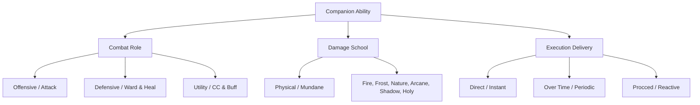
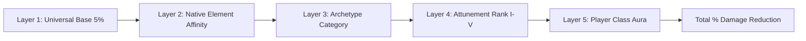
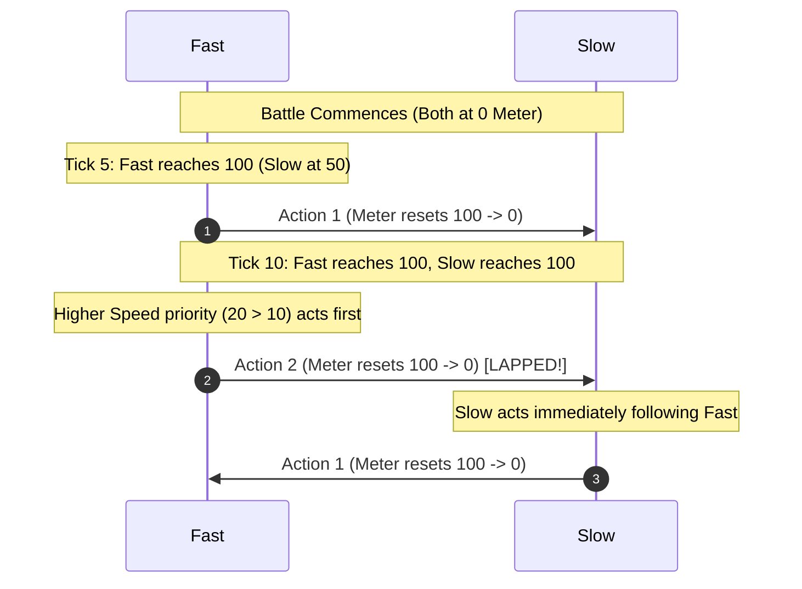

# Forever Safari: Combat Engine, Derived Stats & Mechanics Specification

## 1. Executive Summary & Design Philosophy
*Forever Safari* replaces traditional player character stat bloat with a standardized, Warcraft-native companion combat engine:
1. **Normalized Level-Agnostic Base Budgets**: Creatures do not bake arbitrary level 60 stat multipliers into their database entries. Every creature has a normalized **100-point (Normal / Standard Elite / Boss)** or **110-point (Rare / Rare Elite)** base stat budget.
   * **The Boss vs. Rare Distinction**: A boss is **not** a rare unless it is explicitly flagged as a Rare spawn in the game engine. Standard dungeon and raid bosses (e.g., Magmadar, Princess Theradras, Viscous Fallout) receive the standard **100-point budget**. Only true Rare spawns (`classification == 2`) and Rare Elites (`classification == 4`, e.g., Barnabus, Broken Tooth) receive the **110-point budget**.
2. **Percentile Proportional Reduction & Zero-Drift Rounding**: When reducing raw species stats, the relative proportions of HP, ATK, DEF, and SPD are preserved and scaled to $T = 100$ (or $110$) using the **Largest Remainder Method** to guarantee the sum equals $T$ with zero rounding drift.
3. **Lean Database, Dynamic Engine Derivation**: The creature database stores only fundamental identity markers (`family`, `subFamily`, `spec`, `element`, `classification`, `baseStats`). All secondary combat attributes (resists, armor, crit, dodge) are computed dynamically at runtime.
4. **Static Additive Bonus Layering**: Resistances and defensive bonuses stack additively without compounding mathematical bloat.
5. **Action-Gauge Speed Lapping & Attack Speed Scarcity**: Speed is an active tactical stat driving an Action Meter ($0$ to $100$). Speed is kept scarce and grounded to prevent frictionless combat loops and arms races.

---

## 2. Core Attributes & Base Stat Budgets

Every companion distributes points across **4 Core Stats**:
* **`HP`** (Health / Vitality)
* **`ATK`** (Attack Power / Strike Impact)
* **`DEF`** (Defense / Armor Foundation)
* **`SPD`** (Speed / Action Gauge Velocity)

### A. Budget Allocations by Hunter Archetype

| Archetype | Primary Role | Weighting | Standard / Boss Budget (100 Pts) | Rare & Rare Elite (110 Pts) |
| :--- | :--- | :---: | :---: | :---: |
| **`Tenacity`** | Tank / Mitigation | HP 40% • ATK 16% • DEF 32% • SPD 12% | `HP: 40, ATK: 16, DEF: 32, SPD: 12` | `HP: 44, ATK: 18, DEF: 35, SPD: 13` |
| **`Ferocity`** | Striker / DPS | HP 30% • ATK 36% • DEF 14% • SPD 20% | `HP: 30, ATK: 36, DEF: 14, SPD: 20` | `HP: 33, ATK: 40, DEF: 15, SPD: 22` |
| **`Cunning`** | Agility / Disruptor | HP 26% • ATK 24% • DEF 20% • SPD 30% | `HP: 26, ATK: 24, DEF: 20, SPD: 30` | `HP: 28, ATK: 26, DEF: 22, SPD: 34` |

### B. Proportional Reduction Formula & Zero-Drift Algorithm

For any creature with raw database stats $\text{hp}_{\text{raw}}, \text{atk}_{\text{raw}}, \text{def}_{\text{raw}}, \text{spd}_{\text{raw}}$:
1. **Calculate Raw Total**:
   $$S = \text{hp}_{\text{raw}} + \text{atk}_{\text{raw}} + \text{def}_{\text{raw}} + \text{spd}_{\text{raw}}$$
2. **Compute Percentile Weights**:
   $$P_{\text{stat}} = \frac{\text{stat}_{\text{raw}}}{S}$$
3. **Integer Floor & Remainders** ($T = 100$ or $110$):
   $$\text{base}_{\text{stat}} = \lfloor P_{\text{stat}} \times T \rfloor, \quad \text{rem}_{\text{stat}} = (P_{\text{stat}} \times T) - \text{base}_{\text{stat}}$$
4. **Distribute Leftover Points**:
   $$\text{leftover} = T - \sum \text{base}_{\text{stat}}$$
   Allocate $+1$ point to the stat(s) with the highest remainder $\text{rem}_{\text{stat}}$ (tie-breaker: $\text{HP} \to \text{ATK} \to \text{DEF} \to \text{SPD}$).
   *Guarantees $\text{HP} + \text{ATK} + \text{DEF} + \text{SPD} \equiv T$ with zero rounding drift.*

---

## 3. The 3-Axis Ability Taxonomy

Every ability in `MoveDB` is classified along three distinct dimensions:



---

## 4. Derived Combat Attributes Suite

The combat engine dynamically calculates secondary combat attributes from core stats, archetypes, and passive modifiers:

### A. Offensive Derived Attributes
| Attribute | Engine Role | Runtime Formula |
| :--- | :--- | :--- |
| **Attack Power (AP)** | Scales physical and direct strike damage | $\text{AP} = \text{ATK}$ |
| **Critical Strike Chance (`crit%`)** | Chance to deal 1.5× damage | $\text{Base } 5\% + \left(\frac{\text{SPD}}{10}\right)\% + \text{Ferocity Bonus } (5\%) + \text{Move Crit Bonus}$ |
| **Hit Chance (`hit%`)** | Accuracy check to connect | $\text{Move Accuracy} + \text{Attunement Hit Bonus} - \text{Target Dodge\%}$ |

### B. Defensive Derived Attributes
| Attribute | Engine Role | Runtime Formula |
| :--- | :--- | :--- |
| **Armor (Physical Reduction %)** | Percentage damage reduction against Physical attacks | $\left(\frac{\text{DEF}}{\text{DEF} + 40}\right) \times 100\% + \text{Tenacity Bonus } (10\%) + \text{Warrior Aura}$ |
| **Dodge Chance (`dodge%`)** | Total evasion of incoming physical attacks | $\left(\frac{\text{SPD}}{10}\right)\% + \text{Cunning Bonus } (5\%) + \text{Rogue Passive}$ |
| **Spell Deflection / Miss** | Chance for enemy magical spells to miss | $\text{Cunning Bonus } (5\%) + \text{Attunement Rank Bonus}$ |

---

## 5. Layered Elemental Resistance System

All companions possess innate resistance ratings across all **6 Schools of Magic** (and Physical Armor). 
Resistances stack using **clean, static additive bonuses**:

$$\text{Final Resistance \%} = \text{Base (5\%)} + \text{Type Affinity} + \text{Archetype Bonus} + \text{Attunement Rank} + \text{Player Class Aura}$$



### Layer Breakdown

#### Layer 1: Universal Baseline
* Every creature has a **5% Base Resistance** to Physical, Fire, Frost, Nature, Arcane, Shadow, and Holy damage.

#### Layer 2: Native Element Affinity (+10% to +15%)
* **Fire / Core Hound**: **+15% Fire Resist**
* **Aquatic / Water**: **+15% Frost Resist**
* **Nature / Forest Beasts**: **+10% Nature Resist**
* **Shadow / Undead**: **+15% Shadow Resist**, -5% Holy Resist
* **Arcane / Dragonkin**: **+10% Arcane Resist**, **+5% All Elemental**
* **Mechanical**: **+15% Physical Armor**, -5% Nature Resist

#### Layer 3: Archetype Category Bonuses
* **Tenacity**: **+10% Physical Armor**, **+5% All Magic Resistances**
* **Ferocity**: **+5% Critical Strike Chance**, **+5% Direct Damage Output**
* **Cunning**: **+5% Dodge Chance**, **+5% Spell Deflection**

#### Layer 4: Attunement Rank Growth (+2% per Rank)
* **Rank I (Untamed)**: +0%
* **Rank II (Wary)**: +2% All Resists
* **Rank III (Attuned)**: +4% All Resists
* **Rank IV (Loyal)**: +6% All Resists
* **Rank V (Soulbound)**: **+10% All Resists**

#### Layer 5: Player Class Defenses (Static Slices vs. Procced Wards)

Player class defenses scale dynamically based on the **companion's individual Attunement Rank**, creating a split between physical/wild static mitigation and mystic reactive warded shields:

##### A. Static Slice Classes (Permanent, Always-Active Slices)
* 🛡️ **Warrior (*Marshal's Tenacity*)**: **+5% per Attunement Rank** Physical Damage Reduction / Armor (**5%** at Rank 1 $\to$ **25%** at Rank V).
* 🗡️ **Rogue (*Shadow Evasion*)**: **+5% per Attunement Rank** Enemy Miss Chance / Evasion (**5%** at Rank 1 $\to$ **25%** at Rank V).
* 🏹 **Hunter (*Aspect of the Wild*)**: **+5% per Attunement Rank** Nature Resistance (**5%** at Rank 1 $\to$ **25%** at Rank V).
* 🍃 **Druid (*Gift of the Wild*)**: **+2% per Attunement Rank** Pure Static Omni-Resist across **all 6 magic schools** (**2%** at Rank 1 $\to$ **10%** at Rank V).

##### B. Procced Ward Classes (Mystic / Reactive Elemental Absorption)
* **Proc Rate**: **5% per Attunement Rank** (**5%** at Rank 1 $\to$ **25%** at Rank V).
* **Mitigation Effect (On Proc)**: **10% per Attunement Rank** damage reduction against that strike (**10%** at Rank 1 $\to$ **50%** half-damage reduction at Rank V).
* **DoT (Damage-over-Time) Dynamic Evaluation**:
  * Against periodic damage (e.g. *Corruption*, *Rend*, *Immolate*, *Moonfire*), the proc is **evaluated independently on every single tick**. A companion may resist one tick and take full damage on the next.
* **School Affinities**:
  * 🔮 **Mage (*Arcane Ward*)**: **Arcane, Fire, & Frost**
  * ⚡ **Shaman (*Elemental Shielding*)**: **Fire, Frost, & Nature**
  * 💀 **Warlock (*Fel Infusion*)**: **Shadow & Fire**
  * 🕊️ **Priest (*Ward of the Heavens*)**: **Shadow & Holy**
  * ⚔️ **Paladin (*Devotion / Aegis*)**: **Physical Armor & Holy**

---

## 6. Action-Gauge Speed Lapping System

Combat replaces turn ping-pong with an **Active Action Meter** ($0$ to $100$):

```
+-------------------------------------------------------+
|  ACTION TICKING:  meter = meter + effective_speed      |
|  TRIGGER:         meter >= 100  -->  TAKE ACTION       |
|  DEDUCTION:       meter = meter - 100                 |
+-------------------------------------------------------+
```

### The 2:1 Speed Lapping Mechanics (Speed 20 vs. Speed 10)



### Combat Engine Rules for Lapping

1. **Attack Speed Scarcity & Anti-Friction Philosophy**:
   - High speed is an organic, earned physical trait of specific species rather than a normalized, easily buffed commodity.
   - Generic, spammable speed buffs (e.g. blanket +50% haste buffs across movepools) are deliberately pruned to prevent frictionless combat loops and repetitive arms races.
   - Speed manipulation is restricted to rare signature abilities, priority refunds, and specialized class procs.

2. **Mage Chilling Tempo & Frost Resistance Counterplay**:
   - The Mage class passive channels glass-cannon tempo control via **Chilling Tempo Procs**:
     * **Offensive Proc**: **5% per Attunement Rank** (5% at Rank 1 to **25% at Rank V**) on companion's attack.
     * **Defensive Proc**: **10% per Attunement Rank** (10% at Rank 1 to **50% at Rank V**) when companion is struck.
     * **Debuff**: Inflicts **Chilled** for **2 turns** (halves enemy Speed by **-50%**), opening an active lapping window on the action gauge.
   - **Direct Roll Subtraction**:
     $$\text{Effective Proc \%} = \max\Big(0\%,\ \text{Base Proc \%} - \text{Target Frost Resistance \%}\Big)$$
     * Authentic cold-hardy wild companions (Polar Bears, Winter Wolves, Frostsabers, Snow Owls, Blue Dragonspawn, and Frost Elementals) directly subtract their Frost Resist % from the Mage's proc chance. A companion with 50% Frost Resistance completely nullifies the chill proc.

3. **Action Delays & Priority Refunds**:
   - Heavy signature abilities (e.g. *Magma Blast*) inflict an Action Delay (+20 meter penalty).
   - Light priority strikes (e.g. *Quick Attack*, *Nip*) refund meter (+15 meter bonus), accelerating the next action.
   - Unique high-priority signatures (e.g. Broken Tooth's *Hyper Velocity*) provide a +2 priority lightning opener.

4. **Turn Order Banner**:
   - The battle frame will display upcoming actions sequentially based on real-time gauge velocity: `[Fast] -> [Fast] -> [Slow] -> [Fast]`.

---

## 7. Player Class Tactical Identity & Combat Passives

Player Class passives grant unique tactical flavor and defense layers based on the player's active class (`UnitClass("player")`), scaling cleanly with the active companion's **Attunement Rank (I–V)** using strict `math.ceil()` arithmetic.

```
                      ┌────────────────────────────────────────┐
                      │          UnitClass("player")           │
                      └───────────────────┬────────────────────┘
                                          │
                 ┌────────────────────────┴────────────────────────┐
                 ▼                                                 ▼
   ┌───────────────────────────┐                     ┌───────────────────────────┐
   │    Core/ClassPassives.lua  │                     │   Core/BattleEngine.lua   │
   │  Passive lookup & math    │ ◄───────────────────┤ Damage mitigation, heals, │
   │  ceil modifiers           │                     │ turns, miss chance, ankh  │
   └─────────────┬─────────────┘                     └─────────────┬─────────────┘
                 │                                                 │
                 ▼                                                 ▼
   ┌───────────────────────────┐                     ┌───────────────────────────┐
   │    Core/StatEngine.lua    │                     │    UI/BattleFrame.lua     │
   │  Hunter stat scaling &    │                     │  Priest Divine Grace      │
   │  Druid loyalty bonus      │                     │  tactical command button  │
   └───────────────────────────┘                     └───────────────────────────┘
```

### 7.1 Static Slices (Permanent Innate Defenses)
Always-active defensive reductions applied cleanly as static percentage slices:
* 🛡️ **Warrior (*Marshal's Tenacity*)**: **+5% per Attunement Rank** Physical Damage Reduction / Armor (**5%** at Rank I $\to$ **25%** at Rank V).
* 🗡️ **Rogue (*Shadow Evasion*)**: **+5% per Attunement Rank** Enemy Miss Chance / Evasion (**5%** at Rank I $\to$ **25%** at Rank V).
* 🏹 **Hunter (*Aspect of the Wild & Pathfinder*)**: **+5% per Attunement Rank** Nature Resistance (**5%** at Rank I $\to$ **25%** at Rank V); companion base attack and defense scaled by +5% to +25%.
* 🍃 **Druid (*Gift of the Wild & Ecliptic Tides*)**: **Static Slice**: **+2% per Attunement Rank** Pure Static Omni-Resist across **all 6 magic schools** (**2%** at Rank I $\to$ **10%** at Rank V); channels the active **Ecliptic Tides** celestial pendulum in combat (see 7.3).

### 7.2 Procced Wards (Reactive Elemental Absorption)
Mystic reactive shields that trigger on incoming strikes and periodic ticks:
* **Proc Rate**: **5% per Attunement Rank** (**5%** at Rank I $\to$ **25%** at Rank V).
* **Mitigation on Proc**: **10% per Attunement Rank** damage reduction (**10%** at Rank I $\to$ **50%** half-damage at Rank V).
* **Per-Tick DoT Resolution**: Against damage-over-time effects (*Corruption*, *Rend*, *Immolate*, *Moonfire*), the ward rolls **independently on every single tick**. A companion may resist one tick and take unmitigated damage on the next.
* **School Affinities**:
  * 🔮 **Mage (*Arcane Ward*)**: Arcane, Fire, & Frost.
  * ⚡ **Shaman (*Elemental Shielding*)**: Fire, Frost, & Nature.
  * 💀 **Warlock (*Fel Infusion*)**: Shadow & Fire.
  * 🕊️ **Priest (*Ward of the Heavens*)**: Shadow & Holy.
  * ⚔️ **Paladin (*Aegis of Light*)**: Physical Armor & Holy (plus 5%–25% damage-to-healing conversion via *Aura of Light*).

### 7.3 Special Tactical Combat Mechanics
* 🔮 **Mage Chilling Tempo & Frost Counterplay**:
  * **Offensive Proc**: 5% per Rank (5%–25%) on companion attack.
  * **Defensive Proc**: 10% per Rank (10%–50%) when companion is struck.
  * **Effect**: Inflicts **Chilled** for 2 turns (-50% Speed), opening a speed-lapping window on the action gauge.
  * **Direct Roll Subtraction**: Target's Frost Resistance % directly subtracts from proc chance:
    $$\text{Effective Proc \%} = \max\Big(0\%,\ \text{Base Proc \%} - \text{Frost Resist \%}\Big)$$
    (Hard-countered by cold-hardy beasts: Polar Bears, Winter Wolves, Frostsabers, Snow Owls, Blue Dragonkin, Frost Elementals).
* 🕊️ **Priest Divine Grace**:
  * Provides an active tactical heal command in the battle tray (`UI/BattleFrame.lua`).
  * Charges = Attunement Rank uses per battle.
  * Effect: Instantly heals companion for `math.ceil(maxHP * 0.25)`.
* ⚡ **Shaman Primal Rebirth**:
  * `RollAnkh()` executes on companion fatal damage inside `BE:CheckDefeatPassives()`.
  * 50% chance to resurrect companion at 50% HP once per battle.
* 💀 **Warlock Curse of Suppression**:
  * When facing an enemy AI trainer or PvP opponent, halves all opposed class passives by 50%.
* 🍃 **Druid Ecliptic Tides (The Celestial Pendulum)**:
  * **Dynamic Meter Cap**: Equal to active companion's **Attunement Rank** (1 at Rank I $\to$ 5 at Rank V). Begins at neutral (0 Solar, 0 Lunar).
  * **Point Accrual & Tug-of-War**:
    * Casting an **Offensive** move adds **+1 Solar Point**.
    * Casting a **Non-Offensive** move (Defensive, Healing, Utility) adds **+1 Lunar Point**.
    * If total points reach the meter cap, subsequent opposing actions siphon points from the other side (tug-of-war).
  * **Dual Trigger System**:
    1. **Early Proc Roll (Every Cast)**: Proc chance on every ability cast equals $\text{Points on that side} \times 5\%$ (5% at 1 point $\to$ 25% at 5 points). Early procs discharge immediately at current point value.
    2. **Automatic 100% Discharge**: Reaching maximum capacity on either side ($\text{Solar} == \text{Rank}$ or $\text{Lunar} == \text{Rank}$) triggers a guaranteed maximum Rank discharge automatically!
  * **Surge Effects**:
    * ☀️ **Solar Surge (Offensive Proc / 100% Solar Cap)**:
      * Cleanses 1 active negative debuff (Poison, Bleed, Burn, Sleep, Stun).
      * Applies **Rejuvenating Bloom (HoT)** healing $(\text{Solar Points} \times 5)\%$ Max HP per round for $(\text{Solar Points})$ rounds.
      * Discharges and resets both sides to 0.
    * 🌙 **Lunar Surge (Non-Offensive Proc / 100% Lunar Cap)**:
      * Applies **Bramble Damage Shield** reflecting $(\text{Lunar Points} \times 5)\%$ of incoming damage back to attackers as Nature damage for $(\text{Lunar Points})$ rounds.
      * Discharges and resets both sides to 0.

### 7.4 Engine Execution & UI Hooks
1. **Turn Execution Hooks (`Core/BattleEngine.lua`)**:
   * Apply Warrior Physical mitigation and Ward absorptions inside `BE:ApplyMoveEffects()`.
   * Apply Paladin damage-to-healing conversion.
   * Apply Rogue miss penalty to incoming enemy accuracy checks.
   * Apply Shaman Primal Rebirth check inside `BE:CheckDefeatPassives()`.
   * Evaluate independent Ward proc rolls during each periodic DoT tick.
   * Evaluate Druid move role, update Solar/Lunar points, roll early surge chance ($5\% \times \text{pts}$) or automatic 100% discharge, and tick active HoT / Brambles damage reflection.
2. **Interface Hooks (`UI/BattleFrame.lua`)**:
   * Display active player class aura icon on companion unit frame.
   * Render `[ 💖 Divine Grace (X) ]` button on battle command tray for Priests.
   * Render compact `[ ☀️ Solar: X / Cap | 🌙 Lunar: Y / Cap ]` celestial pendulum tray for Druids.

---

## 8. Progression & Item Integration

1. **Two-Move Starter Rule**:
   - Companions are created with exactly **2 moves**: Slot 1 (Offensive) and Slot 2 (Defensive).
   - Slots 3 and 4 remain empty (`nil`) until unlocked through wild Field Observation or Attunement training.
2. **Boss Encounter Rewards (Catalysts)**:
   - Dungeon and raid bosses do not drop infant companion pups.
   - Slaying a boss yields a **Catalyst Shard** matching their subfamily/family (e.g., Magmadar drops **`Core Hound Catalyst`**, Gahz'rilla drops **`Hydra Catalyst`**, Huhuran drops **`Silithid Catalyst`**).
   - Catalysts are consumed to trigger Metamorphosis evolutions in the Nursery.

---

## 9. Verification & Acceptance Criteria
* [x] **Zero Taint**: All class passive evaluations avoid Blizzard UI namespace pollution and use local closures.
* [x] **Strict Integer Math**: All stat scaling, heals, and mitigation amounts rounded via `math.ceil()`.
* [x] **Deterministic Stat Totals**: Species base stats adhere strictly to 100/110 budgets via Largest Remainder Zero-Drift rounding.
* [x] **Per-Tick DoT Independence**: Periodic effects evaluate reactive ward procs independently per damage tick.
* [x] **Single Source of Truth**: All combat mechanics, formulas, resistance layers, and class passives consolidated in this specification.
