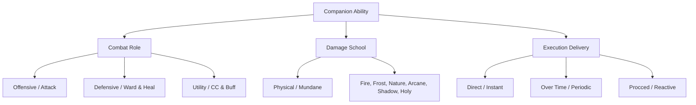
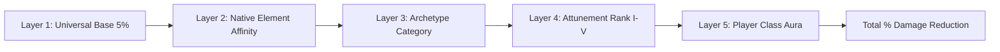
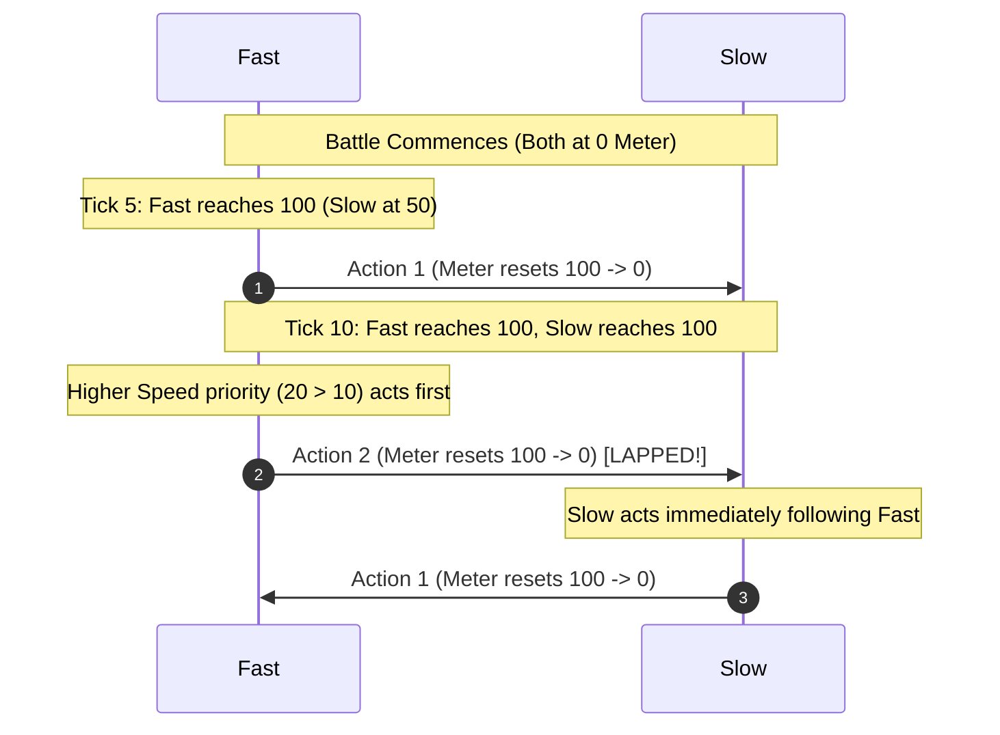

# Forever Safari: Combat Engine, Derived Stats & Mechanics Specification

## 1. Executive Summary & Design Philosophy
*Forever Safari* replaces traditional player character stat bloat with a standardized, Warcraft-native companion combat engine:
1. **Normalized Level-Agnostic Base Budgets**: Creatures do not bake level 60 stats into their database entries. Every creature has a normalized **100-point (Normal)** or **110-point (Rare/Elite/Boss)** base stat budget.
2. **Lean Database, Dynamic Engine Derivation**: The creature database stores only fundamental identity markers (`family`, `subFamily`, `spec`, `element`, `classification`, `baseStats`). All secondary combat attributes (resists, armor, crit, dodge) are computed dynamically at runtime.
3. **Static Additive Bonus Layering**: Resistances and defensive bonuses stack additively without compounding mathematical bloat.
4. **Action-Gauge Speed Lapping**: Speed is an active tactical stat that drives an Action Meter ($0$ to $100$), allowing agile companions to lap slower foes and strike multiple times.

---

## 2. Core Attributes & Base Stat Budgets

Every companion distributes points across **4 Core Stats**:
* **`HP`** (Health / Vitality)
* **`ATK`** (Attack Power / Strike Impact)
* **`DEF`** (Defense / Armor Foundation)
* **`SPD`** (Speed / Action Gauge Velocity)

### Budget Allocations by Hunter Archetype
Budgets are distributed across the 4 stats based on the companion's **Spec Archetype**:

| Archetype | Primary Role | Weighting | Standard Budget (100 Pts) | Rare / Elite / Boss (110 Pts) |
| :--- | :--- | :---: | :---: | :---: |
| **`Tenacity`** | Tank / Mitigation | HP 40% • ATK 16% • DEF 32% • SPD 12% | `HP: 40, ATK: 16, DEF: 32, SPD: 12` | `HP: 44, ATK: 18, DEF: 35, SPD: 13` |
| **`Ferocity`** | Striker / DPS | HP 30% • ATK 36% • DEF 14% • SPD 20% | `HP: 30, ATK: 36, DEF: 14, SPD: 20` | `HP: 33, ATK: 40, DEF: 15, SPD: 22` |
| **`Cunning`** | Agility / Disruptor | HP 26% • ATK 24% • DEF 20% • SPD 30% | `HP: 26, ATK: 24, DEF: 20, SPD: 30` | `HP: 28, ATK: 26, DEF: 22, SPD: 34` |

---

## 3. The 3-Axis Ability Taxonomy

Every ability in `MoveDB` is classified along three distinct dimensions:



---

## 4. Derived Combat Attributes Suite

The combat engine dynamically calculates secondary combat attributes from core stats, archetypes, and passive modifiers:

### A. Offensive Derived Attributes
| Attribute | Engine Role | Runtime Formula |
| :--- | :--- | :--- |
| **Attack Power (AP)** | Scales physical and direct strike damage | $\text{AP} = \text{ATK}$ |
| **Critical Strike Chance (`crit%`)** | Chance to deal 1.5× damage | $\text{Base } 5\% + \left(\frac{\text{SPD}}{10}\right)\% + \text{Ferocity Bonus } (5\%) + \text{Move Crit Bonus}$ |
| **Hit Chance (`hit%`)** | Accuracy check to connect | $\text{Move Accuracy} + \text{Attunement Hit Bonus} - \text{Target Dodge\%}$ |

### B. Defensive Derived Attributes
| Attribute | Engine Role | Runtime Formula |
| :--- | :--- | :--- |
| **Armor (Physical Reduction %)** | Percentage damage reduction against Physical attacks | $\left(\frac{\text{DEF}}{\text{DEF} + 40}\right) \times 100\% + \text{Tenacity Bonus } (10\%) + \text{Warrior Aura}$ |
| **Dodge Chance (`dodge%`)** | Total evasion of incoming physical attacks | $\left(\frac{\text{SPD}}{10}\right)\% + \text{Cunning Bonus } (5\%) + \text{Rogue Passive}$ |
| **Spell Deflection / Miss** | Chance for enemy magical spells to miss | $\text{Cunning Bonus } (5\%) + \text{Attunement Rank Bonus}$ |

---

## 5. Layered Elemental Resistance System

All companions possess innate resistance ratings across all **6 Schools of Magic** (and Physical Armor). 
Resistances stack using **clean, static additive bonuses**:

$$\text{Final Resistance \%} = \text{Base (5\%)} + \text{Type Affinity} + \text{Archetype Bonus} + \text{Attunement Rank} + \text{Player Class Aura}$$



### Layer Breakdown

#### Layer 1: Universal Baseline
* Every creature has a **5% Base Resistance** to Physical, Fire, Frost, Nature, Arcane, Shadow, and Holy damage.

#### Layer 2: Native Element Affinity (+10% to +15%)
* **Fire / Core Hound**: **+15% Fire Resist**
* **Aquatic / Water**: **+15% Frost Resist**
* **Nature / Forest Beasts**: **+10% Nature Resist**
* **Shadow / Undead**: **+15% Shadow Resist**, -5% Holy Resist
* **Arcane / Dragonkin**: **+10% Arcane Resist**, **+5% All Elemental**
* **Mechanical**: **+15% Physical Armor**, -5% Nature Resist

#### Layer 3: Archetype Category Bonuses
* **Tenacity**: **+10% Physical Armor**, **+5% All Magic Resistances**
* **Ferocity**: **+5% Critical Strike Chance**, **+5% Direct Damage Output**
* **Cunning**: **+5% Dodge Chance**, **+5% Spell Deflection**

#### Layer 4: Attunement Rank Growth (+2% per Rank)
* **Rank I (Untamed)**: +0%
* **Rank II (Wary)**: +2% All Resists
* **Rank III (Attuned)**: +4% All Resists
* **Rank IV (Loyal)**: +6% All Resists
* **Rank V (Soulbound)**: **+10% All Resists**

#### Layer 5: Player Class Synergy Auras (Static Additive)
* **Mage** (*Arcane Ward*): **+10% Arcane, Fire, & Frost Resist**
* **Warrior** (*Marshal's Tenacity*): **+10% Physical Armor**
* **Priest** (*Ward of the Heavens*): **+10% Shadow & Holy Resist**
* **Druid** (*Gift of the Wild*): **+5% All Resistances**
* **Shaman** (*Elemental Shielding*): **+10% Fire, Frost, & Nature Resist**
* **Warlock** (*Fel Infusion*): **+10% Shadow & Fire Resist**
* **Paladin** (*Devotion Aura*): **+5% Armor**, **+5% Holy Resist**
* **Rogue** (*Shadow Evasion*): **+5% Dodge Chance**
* **Hunter** (*Aspect of the Wild*): **+10% Nature Resist**, **+5% Beast Damage**

---

## 6. Action-Gauge Speed Lapping System

Combat replaces turn ping-pong with an **Active Action Meter** ($0$ to $100$):

```
+-------------------------------------------------------+
|  ACTION TICKING:  meter = meter + effective_speed      |
|  TRIGGER:         meter >= 100  -->  TAKE ACTION       |
|  DEDUCTION:       meter = meter - 100                 |
+-------------------------------------------------------+
```

### The 2:1 Speed Lapping Mechanics (Speed 20 vs. Speed 10)



### Combat Engine Rules for Lapping
1. **Dynamic Speed Modifiers**:
   - Slow effects (e.g. Mage *Arcane Celerity* -50% SPD) actively delay meter accumulation, creating opportunities for double turns.
   - Speed boosts (e.g. Flying passive +50% SPD above 50% HP) accelerate meter gains.
2. **Action Delays & Refunds**:
   - Heavy signature abilities (e.g. *Magma Blast*) inflict an Action Delay (+20 meter penalty).
   - Light priority strikes (e.g. *Quick Attack*, *Nip*) refund meter (+15 meter bonus), speeding up the next action.
3. **Turn Order Banner**:
   - The battle frame will display upcoming actions sequentially: `[Fast] -> [Fast] -> [Slow] -> [Fast]`.

---

## 7. Progression & Item Integration

1. **Two-Move Starter Rule**:
   - Companions are created with exactly **2 moves**: Slot 1 (Offensive) and Slot 2 (Defensive).
   - Slots 3 and 4 remain empty (`nil`) until unlocked through wild Field Observation or Attunement training.
2. **Boss Encounter Rewards (Catalysts)**:
   - Dungeon and raid bosses do not drop infant companion pups.
   - Slaying a boss yields a **Catalyst Shard** matching their subfamily/family (e.g., Magmadar drops **`Core Hound Catalyst`**, Gahz'rilla drops **`Hydra Catalyst`**, Huhuran drops **`Silithid Catalyst`**).
   - Catalysts are consumed to trigger Metamorphosis evolutions in the Nursery.
