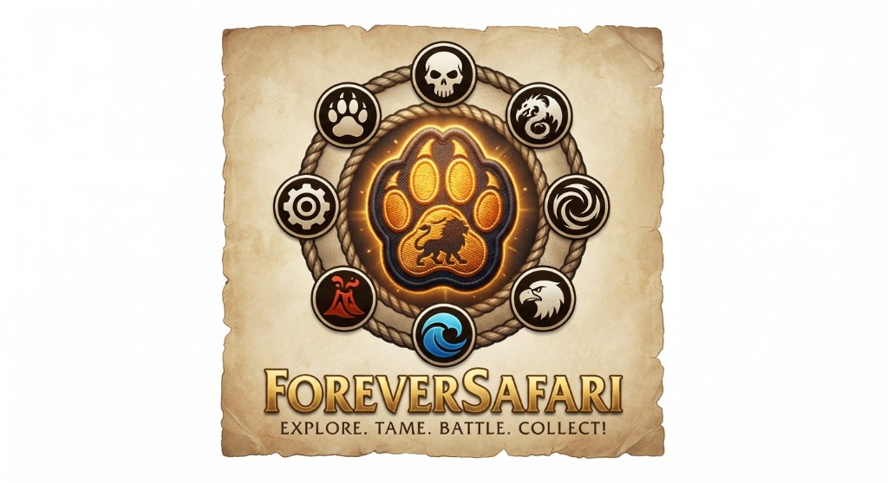

# 📖 Forever Safari — Official Field Manual & Player Guide
**The Definitive Handbook for the Nesingwary Junior Safari League**  
*World of Warcraft: Forever Beta (`_classic_beta_` / `dataEnv: 16`)*

<p align="center">
  
</p>

---

## 🧭 Table of Contents

1. [Welcome to the Junior Safari League](#1-welcome-to-the-junior-safari-league)
2. [Racial Starter Companions](#2-racial-starter-companions)
3. [The 3D Field Guide Journal (`/fs`)](#3-the-3d-field-guide-journal-fs)
4. [Field Stalking & Creature Observation (0% Mob Damage)](#4-field-stalking--creature-observation-0-mob-damage)
5. [Attunement Loyalty, Diets & Move Training](#5-attunement-loyalty-diets--move-training)
6. [Turn-Based Combat & Roaming AI Rival Battlers](#6-turn-based-combat--roaming-ai-rival-battlers)
7. [The Safari Token Economy & Real Quest Rewards](#7-the-safari-token-economy--real-quest-rewards)
8. [Town Facilities & Logistics (Kennel, Outfitter, Mailbox)](#8-town-facilities--logistics-kennel-outfitter-mailbox)
9. [Dungeons, Boss Permits & Evolution Catalysts](#9-dungeons-boss-permits--evolution-catalysts)
10. [Virtual Safari Bag & Gear Progression](#10-virtual-safari-bag--gear-progression)
11. [Multiplayer Duels & 3D Companion Sharing](#11-multiplayer-duels--3d-companion-sharing)
12. [Player Class Passives & Combat Mechanics](#12-player-class-passives--combat-mechanics)
13. [Moonglade Cenarion Nursery & Endgame Breeding](#13-moonglade-cenarion-nursery--endgame-breeding)
14. [Complete Slash Command Reference](#14-complete-slash-command-reference)
15. [Troubleshooting & FAQ](#15-troubleshooting--faq)

---

## 1. Welcome to the Junior Safari League

Upon stepping into Azeroth for the first time with **Forever Safari** installed, an antique parchment dispatch will appear on your screen bearing the official seal of **Hemet Nesingwary Sr.**

### 📦 The Welcome Package
Every recruit is supplied with an official onboarding kit delivered directly to their **Virtual Safari Bag**:
1. **[Caged Starter Companion]** — An authentic wild companion native to your race's starting region, already bonded at **Rank III: Trusting**.
2. **[Copper Snares x 10]** — Hemp rope slip-nooses used to capture wild creatures during turn-based combat.
3. **[Copper Transport Crates x 3]** — Reinforced wooden crates to safely transport excess captures to the town Kennel when your 4-member battle squad is full.
4. **[Safari Healing Salves x 5]** — Soothing remedies to fully restore a wounded companion's health.
5. **[Revival Crystal x 1]** — A charged crystal shard capable of reviving a fainted companion in emergencies.
6. **[Virtual Safari Bag]** — A dedicated 20-slot container that stores all your Safari gear without consuming your regular inventory bag slots.

> [!TIP]
> Access your Virtual Safari Bag at any time by typing `/fsbag` or clicking the backpack icon in your Field Guide Journal header.

---

## 2. Racial Starter Companions

Unlike common wild beasts caught in the wild that start untamed, your racial starter companion is a specially trained partner provided by Hemet Nesingwary. It begins at **Rank III: Trusting** (600 Attunement Points), with full **1.00x True Baseline Stats (100/100 points)**, **5% Disobedience**, and **Slot 3 Unlocked for Training**.

| Race | Starting Zone | Starter Companion | Family | Display ID | Thematic Lore |
| :--- | :--- | :--- | :--- | :---: | :--- |
| 🛡️ **Human** | Elwynn Forest | **Mangy Wolf** | Canine | `903` | Scruffy predator of the Northshire foothills |
| ⛏️ **Dwarf** | Dun Morogh | **Young Black Bear** | Bear | `8843` | Homage to the iconic 2004 cinematic Hunter bear |
| ⚙️ **Gnome** | Dun Morogh | **Crag Boar** | Boar | `138623` | Resilient, plucky grazer of the snowy crags |
| 🌙 **Night Elf** | Teldrassil | **Young Nightsaber** | Cat | `11454` | Agile, moonlit stalker of Shadowglen |
| 🪓 **Orc** | Durotar | **Scorpid Worker** | Scorpid | `2485` | Venomous crawler from the Valley of Trials |
| 🏹 **Troll** | Durotar / Sen'jin | **Bloodtalon Raptor** | Raptor | `1960` | Swift predator honoring the Darkspear Loa |
| 🪶 **Tauren** | Mulgore | **Kodo Calf** | Kodo | `1451` | Gentle yet thunderous powerhouse of the plains |
| 💀 **Undead** | Tirisfal Glades | **Mangy Duskbat** | Bat | `9535` | Nocturnal flier haunting ruined belfries |

---

## 3. The 3D Field Guide Journal (`/fs`)

Type `/fs` to open your interactive 3D Field Guide. The journal is organized into 4 specialized views:

```
+-----------------------------------------------------------------------+
|  [ROSTER]  |  [MENAGERIE]  |  [BESTIARY]  |  [BOUNTIES]     [BAG] [X] |
+-----------------------------------------------------------------------+
|                                                                       |
|   +-----------------------+   +-----------------------------------+   |
|   |                       |   | Name: [ Mangy Wolf          ] [✏️]|   |
|   |                       |   | Type: [Beast]   Rank: III (Trust) |   |
|   |     3D PEDESTAL       |   | HP:  32/32      ATK: 24   DEF: 20 |   |
|   |   (Rotate & Zoom)     |   | SPD: 24         Attunement: 600   |   |
|   |                       |   +-----------------------------------+   |
|   | [⚔Atk][🦁Roar][🏆Win] |   | Active Moves:                     |   |
|   +-----------------------+   | [1: Bite]        [2: Furious Howl]|   |
|                               | [3: Dash]        [4: (Empty)]     |   |
|   Diet Feeding Tray:          +-----------------------------------+   |
|   [🥩 Meat: 5] [🐟 Fish: 0]   | [ 📜 Open Training Grimoire ]     |   |
+-----------------------------------------------------------------------+
| Active Squad: [ 1: Wolf ] [ 2: Bear ] [ 3: (Empty) ] [ 4: (Empty) ]  |
+-----------------------------------------------------------------------+
```

### View 1: 3D Squad Spotlight (`ROSTER`)
* **3D Pedestal Stage**: Click and drag with your mouse to rotate your companion in full 360°. Use the scroll wheel to zoom in and out.
* **Instant Animation Triggers**: Click `[ ⚔ Attack ]`, `[ 🦁 Roar ]`, `[ 🏆 Victory ]`, or `[ 🐾 Idle ]` to watch your companion perform live combat animations.
* **Nickname Customization**: Click the `[ ✏️ ]` pencil button to give your companion a personalized nickname (saved securely with cryptographic DNA signatures).
* **Nourishment Tray**: Displays live inventory counts of compatible dietary food items. Click food buttons directly on the pedestal to feed your active companion (+25 Attunement for Favorite Diets, +15 for Accepted Diets).
* **Beast Training Grimoire Drawer**: Click `[ 📜 Open Training Grimoire ]` to slide out the move-learning drawer and assign unlocked family abilities to Slots 1–4.

### View 2: 3D Menagerie Gallery (`GRID`)
* Browse your entire captured collection in a 6-card 3D paperdoll grid.
* Filter instantly by any of the 8 creature types (*Beast, Mechanical, Undead, Elemental, Dragonkin, Aquatic, Flying, Magic*).
* View real-time health gauges, attunement rank stars, and click `[ Set Active Leader ]` to swap your lead battle companion.

### View 3: Azeroth Bestiary (`BESTIARY`)
* The authentic 2,006-species field Pokédex tracking all 2,008 world creature entities across Classic Azeroth.
* **3 Discovery Tiers**:
  * `[ ??? Undiscovered ]` — Unseen in the wild.
  * `[ 🔭 Seen / Sighted ]` — Observed through field stalking or encountered in combat.
  * `[ 🐾 Captured ]` — Snared or hatched into your squad or kennel.
* Displays verified 3D models, native zone habitats, base stat distributions, Nesingwary lore dossiers, and natural family movepools.
* Real-time search bar and completion percentage progress bar.

### View 4: Field Directives & Research Quest Log (`BOUNTIES`)
* Track active Nesingwary research directives, target quotas, and kill/capture bounties directly while exploring out in the field.

---

## 4. Field Stalking & Creature Observation (0% Mob Damage)

Forever Safari uses a revolutionary **0% Mob Damage Field Observation Architecture**. You never have to damage, whittle down, or kill wild animals to study them. The wild creature remains **100% untouched, un-tagged, and at full health** in the world for hunters and questing adventurers!

```
         [ Quarry Target: Elder Timber Wolf (Lv 10) ]
                            ▲
                            │
               Range: 8 yd  │  Proximity: CLOSE STALK
                            │  Observation Focus: +25%
                            │
                      [ Player ]
```

### Stalking Distance Tiers & Observation Radar HUD
Target any eligible wild creature in the world. The **Observation HUD** (`CaptureHUD`) will appear above your action bars:

1. **Close Stalk (~10 Yards / High Focus)**:
   * **Optimal Observation Focus** (`+25% Attunement & Move Discovery Bonus`).
   * Highest risk of pulling aggro, but optimal vantage point for field study.
2. **Perimeter Range (15–28 Yards / Standard)**:
   * **Baseline Observation Focus** (`1.00x Multiplier`).
   * Safe stalking and observation distance.
3. **Beyond Perimeter (>28 Yards / Out of Range)**:
   * Quarry is too far; close the distance to begin observation.

### 🔬 Pre-Capture Biological Sex Scouting
When targeting any wild creature in Azeroth, the Observation HUD provides real-time biological telemetry:
* **`[ ❓ Sex: Unknown ]`**: Displayed prior to conducting field observation or battle.
* **`[ ♀ Dam ]` / `[ ♂ Sire ]`**: Unlocked once the quarry is studied or encountered in combat, derived deterministically from the creature's world GUID.
* **`[ ⚙ Genderless ]`**: Displayed for all inorganic constructs (`Mechanical` and `Elemental` species).
Because sex is bound to the creature's entity GUID, the observed sex in the field is guaranteed to match the companion you capture into your squad or kennel!

### Channeled Observation Sequence
1. Target an eligible wild creature in the open world.
2. Type `/fs observe`, `/fsnet`, or click the `[ 🔭 Observe Quarry ]` button on the Observation HUD.
3. A **3.0 to 5.0-second channeled cast** begins ("Field Study"). Maintain line-of-sight and stay within 28 yards.
4. Upon completion:
   * **Move Discovery**: The quarry's natural moves are unlocked into your Trainer Grimoire.
   * **Bestiary Sighting**: The species is registered as `[ 🔭 Seen / Sighted ]` in your 2,006-entry Bestiary Pokédex.
   * **Field Loyalty**: Awards **+15 Attunement** to your active companion.
   * The wild creature remains completely unharmed and untouched in the game world!

> [!NOTE]
> **Observation vs. In-Battle Capturing**:
> - **Field Observation (`/fs observe` / HUD)** is used peacefully in the open world to study wild creatures, record Bestiary sightings, and learn new abilities into your Grimoire from a distance.
> - **Capturing with Snares, Nets, Traps & Cages** takes place during **Turn-Based Battle (`/fsbattle`)** by opening `[ BAG ] ➔ [ CAPTURE ]` and deploying physical capture gear against the wild foe.

### 📦 In-Battle Capture & Transport Crate Logistics
When capturing a wild beast during turn-based battle (`/fsbattle`):
* **Open Squad Slot (< 4 members)**: The captured creature joins your active 4-member party immediately with **0 crates consumed**.
* **Full Squad (4/4 members)**: The capture automatically consumes **1 matching (or higher tier) Transport Crate** from your Safari Bag and safely ships the specimen directly to the **Safari Kennel** at the Banker, landing in the first available enclosure with open space.

---

## 5. Attunement Loyalty, Diets & Move Training

Companions in Forever Safari do not gain numerical levels through grinding. Instead, they progress through a deep **5-Rank Attunement Loyalty System** based on care, feeding, survival, and shared adventures.

### 🌟 The 5 Attunement Ranks

| Rank | Title | Attunement | Combat Behavior | Move Slots | Stat Mult | Metamorphosis |
| :---: | :--- | :---: | :--- | :---: | :---: | :---: |
| **I** | **Wild / Unbroken** | 0 – 199 | **15% Disobedience** (loafs, wild attacks). | **1** | **0.85x** | ❌ Destabilizes |
| **II** | **Tolerant** | 200 – 599 | **10% Disobedience** (occasional hesitation). | **2** | **0.95x** | ❌ Destabilizes |
| **III** | **Trusting** | 600 – 1,199 | **5% Disobedience** (reliable partner). | **3** | **1.00x** | ❌ Destabilizes |
| **IV** | **Devoted** | 1,200 – 1,999 | **0% Disobedience** (+5% Critical Strike chance). | **4** | **1.05x** | ❌ Destabilizes |
| **V** | **Bestial Symbiosis** | 2,000+ | **0% Disobedience** (maximum harmony & perk). | **4 + Perk** | **1.15x** | ✅ **Catalyst Ready!** |

### 📈 Earning Attunement
* **Battle Resilience (+35 Attunement)**: Winning a turn-based battle where your companion does not faint.
* **Real Quest Completion (+20 Attunement)**: Turning in any real quest across Azeroth with your companion active.
* **Favorite Family Diet (+25 Attunement)**: Feeding matching dietary food (accompanied by a joyful roar).
* **Accepted Diet (+15 Attunement)**: Feeding secondary sustenance.
* **Native Zone Acclimation (+15 Attunement)**: Exploring in your companion's native home territory.

### 🥩 The 11 Canonical Safari Diets

| Diet Item | Primary Beneficiaries | Dietary Description |
| :--- | :--- | :--- |
| **Safari Meat** | Canines, Felines, Raptors, Crocolisks | Fresh cuts of savory game meat |
| **Safari Fish** | Aquatics, Bears, Shore Birds, River Crocolisks | Freshly caught lake and sea fish |
| **Safari Bread** | Boars, Kodos, Herbivores, Grazers | Hearth-baked wholesome grain loaves |
| **Safari Cheese** | Rodents, Omnivores, Small Mammals | Aged Dalaran sharp cheddar |
| **Safari Fruit** | Avians, Bats, Gorillas, Primates | Sweet jungle melon and wild berries |
| **Safari Fungus** | Spiders, Scorpids, Swamp Scavengers | Damp cave mushrooms and spore caps |
| **Safari Parts** | Mechanicals (Golems, Reapers, Mechs) | Precision gears, cogs, and copper wire |
| **Safari Bonedust** | Undead (Skeletal Beasts, Ghouls) | Ground calcium and crypt residue |
| **Safari Shards** | Magic (Mana Wyrms, Sprite Darters) | Glowing Leyline arcane crystal fragments |
| **Safari Crystals** | Elementals (Fire, Earth, Water, Air) | Elemental geo-cores and primal slag |
| **Safari Runes** | Dragonkin (Whelps, Drakes, Fey Dragons) | Carved draconic stone tablets |

> [!IMPORTANT]
> **Anti-Cannibalism Safeguard**: Companions will reject incompatible food with friendly dialogue (e.g. *"A Wolf refuses to eat Gears!"*). Incompatible food is never consumed or wasted.

### 📜 Beast Training Grimoire, Move Teaching & 4-Role Taxonomy
* All creatures within the same family (e.g. all Felines) share a universal **Family Grimoire**.
* Capturing new wild beasts automatically discovers and unlocks their natural abilities into your Grimoire.
* Open the **Training Drawer** in your Field Guide to assign moves to unlocked Slots (Slot 1–4 unlock as Attunement Rank increases).
* Choose from 94 lore-authentic abilities categorized into a structured **4-Role Taxonomy**:
  * ⚔️ **Offensive** (63 Moves): All damaging attacks (`power > 0`). In turn-based combat, advances the Druid Ecliptic Tides pendulum toward **Solar** power.
  * 🛡️ **Defensive** (8 Moves): Protective barriers, evasion, recovery, and shields (`Cower`, `Shell Shield`, `Frenzied Regeneration`, `Burrow`, `Prowl`, `Hardened Carapace`, `Stone Form`, `Barkskin`). Advances Ecliptic Tides toward **Lunar** power.
  * ⚠️ **Field Hazard** (11 Moves): Ground traps, debuffs, status effects, and control moves (`Screech`, `Faerie Fire`, `Web Wrap`, `Alarm Bark`, `Hyena Cackle`, `Slumbering Venom`, `Sticky Web`, `Spore Cloud`, `Intimidating Roar`, `Stun Needle`, `Dust Cloud`). Advances Ecliptic Tides toward **Lunar** power.
  * 🌦️ **Weather** (12 Moves): Atmospheric environmental shifts and domain conditions (`Rain Dance`, `Sunny Day`, `Sandstorm`, `Blizzard`, `Moonlight`, `Thunderstorm`, `Shadow Mist`, `Toxic Fog`, `Clear Skies`, `Nature's Wrath`, `Volcanic Ash`, `Arcane Winds`). Advances Ecliptic Tides toward **Lunar** power.
* Includes legendary Apex Signatures (**Hyper Velocity**, **King's Roar**, **Void Stream**, **Shadowfang Rend**, **Crushing Clamp**).

---

## 6. Turn-Based Combat & Roaming AI Rival Battlers

Target any creature or rival NPC and type `/fsbattle` (or click `[ BATTLE ]` on your Capture HUD) to engage in retro turn-based combat!

```
+-------------------------------------------------------------+
|  [ENEMY] Defias Highwayman's Bandit Wolf (Lv 12)            |
|  HP: [====================] 100%   Type: Beast              |
|                                                             |
|                       [ 3D ENEMY MODEL ]                    |
|                                                             |
|       [ 3D PLAYER MODEL ]                                   |
|                                                             |
|  [PLAYER] Mangy Wolf (Lv 12)                                |
|  HP: [====================] 100%   Type: Beast              |
+-------------------------------------------------------------+
|  Defias Highwayman: "You picked the wrong road, traveler!"  |
+------------------------------+------------------------------+
|  [ ⚔ FIGHT ]                 |  [ 🎒 BAG ]                  |
|  [ 🐾 TEAM ]                 |  [ 🏃 RUN ]                  |
+------------------------------+------------------------------+
```

### 🌀 The 8-Element 150% Advantage Matrix

Each of the 8 playable creature types deals **150% Super Effective Damage (+50%)** against its prey type and possesses a distinct innate trait:

| Attacking Type | Strong Against (150% Damage) | Innate Trait / Passive Ability |
| :--- | :--- | :--- |
| 🐾 **Beast** | 💀 **Undead** | **Enrage**: Deals +25% extra damage when dropping below 50% HP. |
| 💀 **Undead** | 🐉 **Dragonkin** | **Unholy Immortality**: Survives 1 extra round upon defeat before fainting. |
| 🐉 **Dragonkin** | ✨ **Magic** | **Draconic Fury**: Deals +50% bonus damage after reducing a foe below 50% HP. |
| ✨ **Magic** | 🦅 **Flying** | **Spell Ward**: Cannot take more than 35% Max HP from a single attack. |
| 🦅 **Flying** | 🌊 **Aquatic** | **Aerial Agility**: +50% Speed bonus while above 50% HP. |
| 🌊 **Aquatic** | 🌋 **Elemental** | **Aquatic Resilience**: 50% reduced duration on DoT effects. |
| 🌋 **Elemental** | ⚙️ **Mechanical** | **Primal Purity**: Immune to negative weather & environmental debuffs. |
| ⚙️ **Mechanical** | 🐾 **Beast** | **Fail-Safe Reboot**: Revives once per battle at 20% HP upon fatal blow. |

> [!NOTE]
> **The Nesingwary Safari Code (Zero Humanoid Captures)**: Humanoids across Azeroth (Defias, Kobolds, Murlocs, Pirates, Centaurs, Cultists) are strictly **Rival AI Trainers / Battlers**. You duel them for battle experience and Safari Tokens, but under the League Code, humanoids can **never be snared, caged, or owned as pets**.

### 🤺 Roaming Humanoid AI Trainers (14 Faction Archetypes)
Targeting any roaming Humanoid NPC across Azeroth (e.g. *Defias Cutthroats, Kobold Miners, Murloc Tidecallers, Riverpaw Gnolls, Kolkar Centaurs, Scarlet Crusaders, Dark Iron Dwarves, Syndicate Rogues, Southsea Pirates, Ogres, Twilight Cultists, or Nesingwary Safari Trackers*) triggers an **AI Trainer Battle**:

* **Roster Scaling**:
  * **Level 1–15**: 1 Companion.
  * **Level 16–35**: 2 Companions.
  * **Level 36+**: 3 Companions.
* **Smart AI Switching**: When a trainer's active pet faints, they dynamically summon their bench companions with contextual battle cries.
* **Hunter Protection**: Snares and cages cannot be thrown at trainer-owned pets (`"You cannot capture another hunter's companion!"`).
* **Token Bounties**: Defeating AI Trainers is the primary open-world source of **Safari Tokens** (**6 to 18+ Tokens** per victory).

### ⏱️ Action-Gauge Speed Lapping System (0 to 100 Meters)
Combat abandons rigid turn ping-pong in favor of an **Active Action Meter** ($0$ to $100$):
* Each tick, both active companions gain meter equal to their **Effective Speed**.
* When a companion reaches **100 Meter**, it immediately executes an action and deducts 100 from its meter.
* **2:1 Speed Lapping**: A swift companion with 20 Speed facing a 10 Speed opponent will take **two turns** before the slower foe can act once.
* **Speed Scarcity & Anti-Friction Philosophy**: High speed is an organic, earned physical trait of specific wild species (e.g. Broken Tooth, Cheetahs, Dragonhawks) rather than a cheap, spammable stat. Spammable blanket haste buffs are pruned to ensure tactical counterplay and distinct combat tempo.

### 🛡️ 5-Layer Elemental Resistance Architecture
All companions possess innate elemental resistance ratings across all **6 Schools of Magic** (and Physical Armor):
1. **Layer 1: Universal Baseline**: Every creature starts with a flat **5% Base Resistance** across all damage schools.
2. **Layer 2: Native Element Affinity (+10% clean or +15% / -5% with Weakness)**: Creatures without an elemental weakness gain **+10% Native Resistance**. Creatures with an elemental weakness gain **+15% Native Resistance** and **-5% Weakness School Resistance** (e.g. Undead +15% Shadow / -5% Holy; Mechanical +15% Physical / -5% Nature; Fire +15% Fire / -5% Frost). Dragonkin and Magical species gain **+5% to All Elemental Resistances**.
3. **Layer 3: Archetype Category (+5%, +5% Symmetrical)**: Tenacity (+5% Physical, +5% All Magic); Ferocity (+5% Crit, +5% Direct Damage); Cunning (+5% Dodge, +5% Spell Deflection).
4. **Layer 4: Attunement Rank Growth**: Scales with companion loyalty (+0% at Rank I, +2% at Rank II, +4% at Rank III, +6% at Rank IV, **+10% at Rank V**).
5. **Layer 5: Player Class Defenses**: Distinct player aura providing either permanent **Static Slices** or reactive **Procced Wards** (detailed in Section 12).

### 👥 Cooperative Party Battles & Virtual Duos
* **Disparity Compounding Scaling**: Multi-player team battles scale automatically against party disparity: $\Delta = \max(0, \text{Players} - \text{NPCs})$. In 2-NPC Virtual Duo encounters:
  * **1–2 Players**: $1.0000\times$ (Baseline).
  * **3 Players**: $\mathbf{1.2500\times}$ (+25% Max HP & damage).
  * **4 Players**: $\mathbf{1.3750\times}$ (+10% compounding).
  * **5 Players**: $\mathbf{1.4438\times}$ (+5% compounding, Duo Cap).
* **The Cenarion Twins Virtual Duo (Silithus)**:
  * Challenged at Cenarion Hold, **Jarund Stoutstrider & Layo Starstrike** command an authentic 8-companion joint roster (Spirit Wolf, War Kodo, Thunder Lizard, Ancients, Nightsaber, Lunar Owl, Sprite Darter), each built strictly to the 100-Point Budget Law.
  * **Dual-Line Druid Ecliptic Meter**: Jarund generates Solar (☀️) and Layo generates Lunar (🌙). Both *Solar Bloom* (+12% Max HP HoT) and *Lunar Brambles* (40% thorns reflect) can be active simultaneously.
  * **Sympathetic Buffing & 50% Sympathetic Healing**: Beneficial buffs or shields cast by either Twin replicate across both active companions and decay only every 2 enemy turns. Furthermore, if either pet heals through a primary or secondary effect (direct heals, drains, regeneration HoT), 50% of that healing is sympathetically transferred to the other active companion.
* **Pre-Battle Pet Designation & Squad Quotas**:
  * Before combat begins, check the `DeployCheck` checkboxes on your `ForeverSafariPlayerParty` slots to select which companions enter battle.
  * **Squad Limits**: 4–5 players = 2 pets; 3 players = 3 pets; 1–2 players = 4 pets.
  * Upon turn 1, your squad locks permanently (`combatStarted = true`). Benched pets are labeled `[BENCH]` and cannot be swapped in.
* **15-Second Action Timeout**:
  * An animated countdown bar monitors player turns. If 15 seconds expire without an action, the engine auto-commits Move 1.
* **Boss AoE Cleave**:
  * Boss-tier abilities deal full damage to your active companion and strike all conscious reserve companions for 50% collateral damage, evaluated against each pet's individual Defense and resistance layers.

---

## 7. The Safari Token Economy & Real Quest Rewards

Safari Tokens (`[INV_Misc_Coin_02]`) are the official currency of the Nesingwary Safari League.

### 💰 Earning Safari Tokens
1. **Real Quest Turn-Ins across Azeroth (`QUEST_TURNED_IN`)**:
   * Earn **1/10 of the quest level, rounded up** (`math.ceil(QuestLevel / 10)`), minimum 1 Token.
   * *Examples*: Lv.1–10 = **+1 Token**; Lv.11–20 = **+2 Tokens**; Lv.21–30 = **+3 Tokens**; Lv.31–40 = **+4 Tokens**; Lv.41–50 = **+5 Tokens**; Lv.51–60 = **+6 Tokens**; Lv.61–70 = **+7 Tokens**; Lv.71–80 = **+8 Tokens**.
2. **Defeating Roaming Humanoid AI Trainers**: **+6 to +18 Tokens** based on faction tier and level.
3. **Completing Official Nesingwary Mailbox Bounties**: **+15 to +50 Tokens** per completed research directive.
4. **Retroactive Back-Quest Compensation**: Installing Forever Safari on an existing character automatically calculates all previously completed quests (`C_QuestLog.GetAllCompletedQuestIDs`) and delivers a lump-sum **Safari Research Grant** in your welcome dispatch.

---

## 8. Town Facilities & Logistics (Junior Safari League Gossip & Vault)

Forever Safari operates with **Zero Out-of-World Cheat Access** and **Zero Automatic Frame Intrusions**. Services are accessed strictly on demand through Blizzard's native NPC dialogue and banking interfaces.

> [!NOTE]
> **Silence on Non-Service NPCs**: Interacting with generic world NPCs (guards, vendors, flight masters, quest givers) will never trigger addon popups or HUD elements.
> **Universal Row-Stacking**: On any NPC dialogue with third-party addon modifications (e.g. Olympus's *Bones!: Teach me Bones*, Questie), Forever Safari dynamically anchors directly beneath the lowest external element, guaranteed to sit at the bottom without overlapping.

### 🏨 1. Innkeepers (Junior Safari League: Rest & Revive Squad)
Interact with any town **Innkeeper**:
* **Opt-In Dialogue Option**: Appends `Junior Safari League: Rest and Revive Squad` to Blizzard's native `GossipFrame`.
* **Squad Restoration**: Fully revives fainted companions and heals all squad and reserve companions to 100% HP.
* **Exclusive Medical Sanctuary**: Innkeepers strictly handle squad recuperation and resting; they do not sell supplies or manage bank vaults.

### 🎯 2. Pet Trainers (Outfitters, Healers & Capital City Breeders)
Interact with any **Pet Trainer** in any major city or settlement (accessible to **all classes**, not just Hunters):
* **Junior Safari League: Visit Outfitter**: Opens the Nesingwary Safari Outfitter shop (`/fsshop`) with Capture Gear, Transport Crates, Diets, and Medicine.
* **Early-Game Companion Breeding**: Pet Trainers in Capital Cities facilitate early-game breeding (offspring hatches at Rank I: Untamed).
* **Companion Rest & Healing**: Revives and fully heals party companions.

### 🏇 3. Stable Masters (Outpost Leaders & Regional Circuit)
Interact with regional **Stable Masters**:
* **Specialized Interaction HUD**: Because Stable Masters on *WoW: Forever* terminate gossip sessions for non-Hunters via server-side class validation, Forever Safari provides a dedicated on-target specialized interaction HUD to challenge Outpost Leaders across regional circuits.

### 🌿 4. Cenarion Keepers (Moonglade Sacred Grove Sanctuary)
Interact with any Cenarion Keeper in Moonglade (Nighthaven):
* **Junior Safari League: Breed My Pet**: Opens the Sacred Grove Nursery interface (`/fsnursery`) to breed companions (offspring hatches at Rank III: Attuned with 100 base stat points and 0% disobedience).

### 🏦 5. Bankers (Kennelers & Companion Reserve)
Interact with any town **Banker** (or open any Bank Vault):
* **On-Demand Companion Vault**: Opens the companion reserve (`/fskennel` or `/fs kennel`) featuring a massive **2,006-slot vault** organized into **101 Enclosures** — providing exactly 1 slot for every unique species in Azeroth under the **Highlander Law**.
* **Enclosure Switcher & Shift-Click Skipping**: Fast navigation with `[ ◀ Prev ]` / `[ Next ▶ ]` buttons (Click: $\pm 1$ enclosure; Shift-Click: $\pm 10$ enclosures).
* **Scrollable Jump Menu & Direct Numeric Entry**: Click `[ Jump ▼ ]` to open a scrollable list of all 101 enclosures showing live counts and capacities (e.g. `101. Enclosure 101 (6/6)`), or enter any enclosure number (1–101) directly and press `[ Go ]`.
* **Custom Enclosure Renaming**: Click `[ 🏷 Rename ]` to label enclosures (e.g. *'PvP Squad'*, *'Breeding Dams'*, *'Apex Vault'*).
* **Safari Journal Filter Ribbon**: Real-time name search, creature type/family dropdown, biological sex filter (`♂ Sire`, `♀ Dam`, `⚙ Genderless`), and rarity filter (`👑 Apex`).
* **Transport Crate Logistics**: Wild captures beyond your 4-member squad consume a transport crate and automatically route to the next available enclosure with open space.
* **Clean Cleanup**: Closes cleanly whenever the banker interaction terminates.

### 📮 6. Mailboxes (Nesingwary Safari Dispatch Hub)
Interact with any physical **Mailbox** in town:
* Click the custom **[Safari]** tab docked to Blizzard's `MailFrame`.
* View received letters, bounty assignments, and unbox parcels containing earned token grants and supplies.

---

## 9. Dungeons, Boss Permits & Evolution Catalysts

### 🗝️ Dungeon Boss Research Permits
Certain creature types require specialized field research permits before they can be snared in the wild. Defeating iconic dungeon bosses synchronizes permits across your entire party:

* ⚙️ **Mechanical Permit**: Defeat *Sneed's Shredder* or *Foe Reaper* in Deadmines.
* 🌋 **Elemental Permit**: Defeat *Viscous Fallout* in Gnomeregan (or *Baron Aquanis* in BFD).
* 💀 **Undead Permit**: Defeat *Amnennar the Coldbringer* in Razorfen Downs.
* 🐉 **Dragonkin Permit**: Defeat *Avatar of Hakkar* or *Morphaz/Hazzas* in Sunken Temple.

### 🧬 Evolution Catalysts, Minor Shards & Greed-Only Boss Loot
* **Dungeon Boss Catalysts**: Dungeon bosses drop rare **Evolution Catalysts** (such as *[Shadowfang Essence]* or *[Hydra Bile]*).
* **Greed-Only Fair Roll**: Defeating a dungeon boss triggers a dedicated secondary roll window for all party members (Need is permanently disabled).
* **✨ Minor Evolution Shards (0.1% Dungeon Trash Drops)**:
  * Regular dungeon trash mobs have a **0.1% chance (1 in 1,000)** to drop a **[Minor Evolution Shard]** directly into your Virtual Safari Bag.
  * **Instant Forge (10-to-1 Combining)**: Right-clicking a stack of **10 Minor Evolution Shards** in your Safari Bag instantly consumes them and forges **1 Full Evolution Catalyst** with an enchanting fanfare and toast notification!
* **Rank V Metamorphosis**: When a companion reaches **Rank V: Bestial Symbiosis** (2,000 Attunement), using its matching catalyst triggers a magnificent 3D evolution:
  * **Mangy Wolf** ➔ **Slavering Worg**
  * **Young Black Bear** ➔ **Ironfur Patriarch**
  * **Crag Boar** ➔ **Raging Ashboar**
  * **Young Nightsaber** ➔ **Shadowstalker Panther**
  * **Scorpid Worker** ➔ **Deathstalker Scorpid**
  * **Bloodtalon Raptor** ➔ **Savage Bloodseeker**
  * Evolutions scale base stats, unlock apex move pools, and update 3D display models while preserving custom nicknames and learned grimoires!

### 🛡️ Instance HUD Suppression
* While inside any dungeon, raid, or PvP battleground instance, the **Capture Radar HUD is automatically suppressed and hidden**. This ensures zero UI distractions during group combat while keeping boss drops, quest turn-ins, and minor catalyst shard looting active in the background.

### 👑 World Rare Spawn Protection
* Genuine wild rare spawns (e.g. *Humar the Pridelord*, *Broken Tooth*, *The Rake*) display an unforgeable **Golden Rare Dragon Crest** in the 3D Inspector.
* Common pets cannot be renamed after registered world rares.
* World rares are legendary apex creatures and cannot be evolved, preserving their iconic wild prestige.

---

## 10. Virtual Safari Bag & Gear Progression

Type `/fs bag` or `/fsbag` to open your 20-slot Virtual Safari Bag.

### 🕸️ 4-Tier Capture Gear

| Tier | Item Name | Icon | Token Cost | Base Catch Power | Target Level Band |
| :---: | :--- | :--- | :---: | :---: | :---: |
| **1 (Common)** | **Copper Snare** | `INV_Misc_Noose_01` | **1 Token** | **35%** | Levels 1–15 |
| **2 (Uncommon)** | **Iron Safari Net** | `Hunter_PvP_TrackersNet` | **5 Tokens** | **55%** | Levels 16–30 |
| **3 (Rare)** | **Mithril Hunter Trap** | `INV_Pet_PetTrap` | **10 Tokens** | **75%** | Levels 31–45 |
| **4 (Epic)** | **Thorium Expedition Cage** | `INV_Box_Birdcage_01` | **25 Tokens** | **98%** | Levels 46–60 |

#### 🎯 Master Capture Formula & Health Dynamics
Capturing a wild creature requires engaging them in turn-based combat (`/fsbattle`) and throwing capture gear from `[ BAG ] ➔ [ CAPTURE ]`:
* **50% HP Pivot Point**:
  * **Above 50% HP (Penalty)**: $1:1$ penalty. Lose **1% catch chance per 1% HP above 50%**. A Copper Snare against a target at 100% HP has $35\% - 50\% = -15\% \le 0\%$ chance, preventing full-health cheese captures.
  * **Below 50% HP (Bonus)**: $2:1$ bonus. Gain **+1% catch chance per 2% HP below 50%**. Lowering target to 10% HP grants a **+20% catch bonus** (Copper reaches 55%, Iron reaches 75%).
  * **At 50% HP**: Trap operates at its exact baseline capture rate.
* **Tier Mismatch Scaling**:
  * **Over-geared (Higher Tier Trap on Lower Level Quarry)**: Grants **+25% flat catch bonus per tier down**.
  * **Under-geared (Lower Tier Trap on Higher Level Quarry)**: **Halves capture chance per tier up** ($\times 0.5$ per tier difference).
* **Wild Rare Quarry Resistance**: Wild Rare spawns possess innate capture resilience, applying a flat **-10% penalty** to capture rolls.
* **Hunter Beastmastery Multiplier**: Hunters enjoy **+25% multiplicative catch chance** and **+25% faster Attunement accrual** across all pets!

### 📦 4-Tier Transport Crates

| Tier | Item Name | Icon | Token Cost | Purpose |
| :---: | :--- | :--- | :---: | :--- |
| **1 (Common)** | **Copper Transport Crate** | `INV_Box_PetCarrier_01` | **1 Token** | Ships Common / Small Game to Kennel |
| **2 (Uncommon)** | **Iron Transport Crate** | `INV_Box_PetCarrier_01` | **5 Tokens** | Ships Uncommon quarry to Kennel |
| **3 (Rare)** | **Mithril Transport Crate** | `INV_Box_PetCarrier_01` | **10 Tokens** | Ships Rare quarry to Kennel |
| **4 (Epic)** | **Thorium Transport Crate** | `INV_Box_PetCarrier_01` | **25 Tokens** | Ships Epic / Apex quarry to Kennel |

---

## 11. Multiplayer Duels & 3D Companion Sharing

* **Shift-Click 3D Chat Links**: Shift-Click any companion in your Field Guide to share an interactive link in chat: `[Safari: Mangy Wolf (3D)]`.
* **3D Inspector Popup**: Clicking any companion link in chat opens an interactive 3D paperdoll showing that player's companion, custom nickname, stats, and active 4-move loadout.
* **Player Duels (`/fsduel`)**: Target another player with Forever Safari and type `/fsduel` to engage in turn-based multiplayer companion duels over wireless addon comms.

---

## 12. Player Class Passives & Combat Mechanics

Every character class in World of Warcraft grants an authentic tactical identity and defense layer to all active companions owned by that character. **Bonuses scale dynamically based on the active companion's Attunement Rank (I–V)** using strict `math.ceil()` arithmetic.

Class defenses are organized into two distinct paradigms:
* **Static Slices**: Permanent, always-active percentage mitigation slices (Warrior, Rogue, Hunter, Druid).
* **Procced Wards**: Mystic reactive elemental absorption that rolls a **5% per Rank proc chance** (5%–25%) to absorb **10% per Rank incoming damage** (10%–50%) on direct hits and **independently rolls on every single DoT tick** (Mage, Shaman, Warlock, Priest, Paladin).

| Class | Passive & Ward | Defense Paradigm | Effect Details (Rank 1 ➔ Rank 5) |
| :--- | :--- | :--- | :--- |
| 🛡️ **Warrior** | **Marshal's Tenacity** | **Static Slice** | Reduces all incoming physical damage dealt to your companion by **+5% per Rank** (**5%** at Rank I $\to$ **25%** at Rank V). |
| 🗡️ **Rogue** | **Shadow Evasion** | **Static Slice** | Increases companion Dodge Chance by **+5% per Rank** (**5%** at Rank I $\to$ **25%** at Rank V). Fully **synergizes with the Cunning archetype's +5% Dodge**, providing up to **30% total Dodge Chance** at Rank V. |
| 🏹 **Hunter** | **Aspect of the Beastmaster** | **Static Slice & Mastery** | **Master Tracker & Tamer**: Companions accrue **+25% Attunement** from all sources, and capture chance for wild creatures is increased by **+25% (multiplicative)**. Companion also gains **+5% per Rank** Nature Resistance (**5%** at Rank I $\to$ **25%** at Rank V). |
| 🍃 **Druid** | **Gift of the Wild & Ecliptic Tides** | **Static Slice & Pendulum** | **+2% per Rank** Pure Static Omni-Resist across **all 6 magic schools** (**2%** at Rank I $\to$ **10%** at Rank V), plus the in-combat **Ecliptic Tides** celestial pendulum (see below). |
| 🔮 **Mage** | **Arcane Ward & Chilling Tempo** | **Procced Ward (Arcane, Fire, Frost)** | **Ward**: 5% per Rank proc to absorb 10% per Rank damage (rolled per hit and per DoT tick).<br>**Chilling Tempo**: 5% off / 10% def proc to inflict **Chilled** (-50% SPD for 2 turns). Proportionally reduced by target's Frost Resistance % (e.g., at 50% frost resist, a 50% proc chance lowers to 25%). |
| ⚡ **Shaman** | **Elemental Shielding & Primal Rebirth** | **Procced Ward (Fire, Frost, Nature)** | **Ward**: 5% per Rank proc to absorb 10% per Rank damage (rolled per hit and per DoT tick).<br>**Primal Rebirth**: `RollAnkh()` flat **50% chance** to resurrect companion at 50% HP once per battle upon defeat. |
| 💀 **Warlock** | **Fel Infusion & Suppression** | **Procced Ward (Shadow, Fire)** | **Ward**: 5% per Rank proc to absorb 10% per Rank damage (rolled per hit and per DoT tick).<br>**Curse of Suppression**: Halves all opposed player/trainer class passives by **50%** in duels and AI battles. |
| 🕊️ **Priest** | **Ward of the Heavens & Divine Grace** | **Procced Ward (Shadow, Holy)** | **Ward**: 5% per Rank proc to absorb 10% per Rank damage (rolled per hit and per DoT tick).<br>**Divine Grace**: Active battle tray button usable `Rank` times (1–5) per battle; heals companion for `math.ceil(maxHP * 0.25)`. |
| ⚔️ **Paladin** | **Aegis of Light & Aura of Light** | **Procced Ward (Physical, Holy)** | **Ward**: 5% per Rank proc to absorb 10% per Rank damage (rolled per hit and per DoT tick).<br>**Aura of Light**: Converts **5% to 25%** of absorbed/mitigated damage back into healing. |

### 🍃 Druid: Ecliptic Tides (The Celestial Pendulum)
For Druid characters, turn-based combat features an active celestial pendulum above the companion tray:
* **Meter Capacity**: Capped at the active companion's **Attunement Rank** (1 at Rank I $\to$ 5 at Rank V), starting at neutral ($0/0$).
* **Role Accrual & Tug-of-War**:
  * **Offensive moves** add **+1 Solar Point**.
  * **Non-Offensive moves** (Defensive, Healing, Utility) add **+1 Lunar Point**.
  * Siphons points from the opposite side if the pool is full.
* **Dual Trigger Resolution**:
  * **Early Proc Roll**: Every cast rolls a $\text{Points on that side} \times 5\%$ chance (5% at 1 pt $\to$ 25% at 5 pts) to trigger immediately.
  * **Automatic 100% Discharge**: Reaching full capacity on either side guarantees a maximum Rank discharge automatically!
* **Surges**:
  * ☀️ **Solar Surge**: Cleanses 1 negative debuff + applies **Rejuvenating Bloom (HoT)** healing $(\text{Solar Points} \times 5)\%$ Max HP/round for $(\text{Solar Points})$ rounds. Resets to $0/0$.
  * 🌙 **Lunar Surge**: Applies **Bramble Damage Shield** reflecting $(\text{Lunar Points} \times 5)\%$ incoming damage back as Nature damage for $(\text{Lunar Points})$ rounds. Resets to $0/0$.

---

## 13. Tiered Companion Breeding & Nursery Sanctuaries

Breeding in *Forever Safari* is split into two distinct tiers:
1. **Capital City Nurseries (Pet Trainers)**: Available early in your journey across Stormwind, Orgrimmar, Ironforge, Thunder Bluff, Darnassus, and Undercity. Offspring hatches at **Rank I: Untamed** (0 Attunement points).
2. **Moonglade Cenarion Nursery (Sacred Grove)**: The premier endgame co-op breeding sanctuary (`/fsnursery`) hosted by the Cenarion Circle in Moonglade (Nighthaven). Offspring hatches at **Rank III: Attuned** (100 base stat points, 0% disobedience, immediate battle readiness).

```
+-----------------------------------------------------------------------+
|  🌿 MOONGLADE CENARION NURSERY — SACRED CO-OP BREEDING SANCTUARY      |
+-----------------------------------------------------------------------+
|  [ Candidate 1: Trainer ]             [ Candidate 2: Mate / Partner ] |
|  +-----------------------+            +-----------------------+       |
|  |     3D PEDESTAL       |            |     3D PEDESTAL       |       |
|  |   Rank V: Apex Canine |            |   Rank V: Apex Canine |       |
|  |     ♂ Sire (Signed)   |            |     ♀ Dam (Signed)    |       |
|  +-----------------------+            +-----------------------+       |
|                                                                       |
|  CHECKLIST:                                                           |
|  1. Family Harmony:         [ ✔ Purebred Canine Match ]               |
|  2. Apex Attunement:        [ ✔ Both Rank V: Bestial Symbiosis ]      |
|  3. Biological Designation: [ ✔ 1x Sire (♂) + 1x Dam (♀) ]            |
|                                                                       |
|  ⚠ THE ULTIMATE SACRIFICE: Parents are PERMANENTLY consumed from vault|
|  [ Guaranteed 2 Safari Eggs (Split) + 20% Chance for 3rd Bonus Egg ]  |
|                                                                       |
|             [ COMMENCE SACRED BREEDING RITUAL ]                       |
+-----------------------------------------------------------------------+
```

### 🧬 Biological Designation & Requirements
* **Anatomy**: Biological companions possess deterministic wild anatomy as either **Sire (♂)** or **Dam (♀)**, cryptographically signed into their League DNA signature.
* **Genderless Constructs**: `Mechanical` and `Elemental` companions are categorized as **Genderless (⚙)** and can undergo **Construct Matrix Re-forging** in the Nursery when paired with a matching construct and a slotted **Family Catalyst**.
* **Exact Same Family**: Both candidates must belong to the same species family (e.g. Canine + Canine, Feline + Feline, Bear + Bear).
* **Rank V (Bestial Symbiosis)**: Both candidates must be fully attuned at Rank V (1000 Loyalty).
* **Compatible Pair**: Requires either **1x Sire (♂) + 1x Dam (♀)** or **2x Genderless Constructs (⚙) + Slotted Catalyst**.

### 💀 The Ultimate Sacrifice & Egg Payout
* Breeding requires both parents to merge their life forces: **both candidates are PERMANENTLY consumed from your vault/collection**.
* **Guaranteed Eggs**: Each trainer receives **1 purebred Safari Egg** stored in their Safari Bag (`/fsbag`).
* **20% Bonus 3rd Egg Roll**: Exactly a 20% chance to produce a 3rd bonus egg! In co-op, the bonus egg is awarded via a 50/50 roll between the two trainers. In solo breeding, the trainer receives all 3 eggs.
* **Incubation**: Open your Safari Bag (`/fsbag`) and **Right-Click** any Safari Egg to hatch a purebred level 1 newborn with superior inherited IV baseline stats and learned family moves!

---

## 14. Complete Slash Command Reference

| Command | Shorthand | Description |
| :--- | :--- | :--- |
| `/fs` | — | Opens the 3D Field Guide Journal & Squad Manager. |
| `/fs bag` | `/fsbag` | Opens the 20-slot Virtual Safari Bag container. |
| `/fs kennel` | `/fskennel` | Opens the Safari Kennel (Requires Banker interaction). |
| `/fs shop` | `/fsshop` | Opens the Nesingwary Safari Outfitter (Requires Pet Trainer). |
| `/fs mail` | `/fsmail` | Opens Nesingwary Safari Correspondence at a Mailbox. |
| `/fs nursery` | `/fsnursery`, `/fsbreed` | Opens Moonglade Cenarion Nursery Breeding Sanctuary. |
| `/fs bounties` | — | Opens Tab 4: Field Directives & Research Quest Log. |
| `/fs observe` | `/fsnet` | Starts field observation channel on your targeted quarry. |
| `/fs battle` | `/fsbattle` | Engages targeted creature or humanoid in turn-based combat. |
| `/fs duel [player]` | `/fsduel` | Challenges targeted player to a companion duel. |
| `/fs war` | `/fswar` | Territory War commands (`setnode`, `setbase`, `start`, `stop`, `bridge`). |
| `/fs tokens` | — | Displays current Safari Token balance in chat. |
| `/fs abandon` | `/fs release` | Releases active companion back to the wild (with confirmation). |
| `/fs reset` | — | Resets all addon data back to a fresh recruit state. |
| `/fs taint` | `/fstaint` | Runs live Blizzard UI taint diagnostics on gossip, bags, and secure frames. |
| `/fs benchmark` | — | Profiles cryptographic persistence and vault deserialization. |

---

## 15. Troubleshooting & FAQ

### Q: Why can't I catch Humanoids, Centaurs, or Murlocs with snares?
**A**: Under the Nesingwary Safari Code, sapient and civilized humanoids cannot be captured into cages. Instead, targeting humanoids initiates a **Rival Battler AI Trainer Battle**, rewarding you with Safari Tokens!

### Q: Do I need to be a Hunter to play Forever Safari?
**A**: No! Forever Safari is built for **all classes** (Warriors, Mages, Rogues, Priests, Warlocks, Paladins, Shamans, Druids, and Hunters). All classes can capture, train, battle, feed, and evolve companions.

### Q: Where are my captured pets if my party is full?
**A**: When your 4-member active squad is full, new captures are crated and shipped directly to the **Safari Kennel**. Visit any **Banker** in town to view and withdraw your banked companions across 5 storage boxes.

### Q: Does Forever Safari cause UI taint in dungeons or raids?
**A**: Zero taint! Forever Safari features full `pcall`-guarded secret value inspection compatible with modern anti-automation systems in dungeons, raids, and active combat. All windows operate as standalone sidecars without modifying Blizzard's secure execution paths.

---

*Good hunting, recruit! Make Hemet Nesingwary proud.* 🐾
