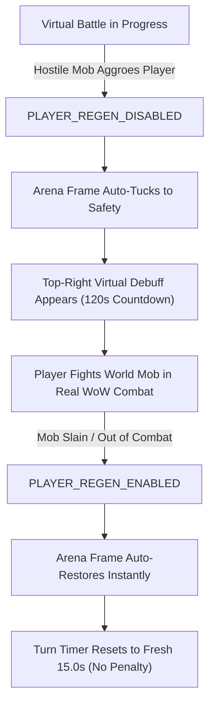

# 📖 Forever Safari — Official Field Manual & Player Guide
**The Definitive Handbook for the Nesingwary Junior Safari League**  
*World of Warcraft: Forever Beta (`_classic_beta_` / `dataEnv: 16`)*

<p align="center">
  
</p>

---

## 🧭 Table of Contents

1. [The Junior Safari League Creed & Induction](#1-the-junior-safari-league-creed--induction)
2. [Controls, Navigation & The Golden Minimap Compass](#2-controls-navigation--the-golden-minimap-compass)
3. [Racial Starter Companions & Heritage](#3-racial-starter-companions--heritage)
4. [The 3D Field Guide Journal (`/fs`) & Bestiary Masking](#4-the-3d-field-guide-journal-fs--bestiary-masking)
5. [Field Stalking & Creature Observation (0% Mob Damage)](#5-field-stalking--creature-observation-0-mob-damage)
6. [Attunement Loyalty, Diets & Move Training](#6-attunement-loyalty-diets--move-training)
7. [The Virtual Arena & 120s World Combat Suspension](#7-the-virtual-arena--120s-world-combat-suspension)
8. [The Safari Token Economy & Real Quest Rewards](#8-the-safari-token-economy--real-quest-rewards)
9. [Town Facilities & Logistics (101-Enclosure Banker Vault)](#9-town-facilities--logistics-101-enclosure-banker-vault)
10. [Dungeons, Boss Permits & Evolution Catalysts](#10-dungeons-boss-permits--evolution-catalysts)
11. [Virtual Safari Bag & Gear Progression](#11-virtual-safari-bag--gear-progression)
12. [Multiplayer Duels & 3D Companion Sharing](#12-multiplayer-duels--3d-companion-sharing)
13. [Player Class Passives & Combat Mechanics](#13-player-class-passives--combat-mechanics)
14. [Tiered Companion Breeding & Nursery Sanctuaries](#14-tiered-companion-breeding--nursery-sanctuaries)
15. [Cryptic Whispers & Expedition Legends](#15-cryptic-whispers--expedition-legends)
16. [Complete Slash Command Reference](#16-complete-slash-command-reference)
17. [Appendix: Field Diagnostics & Troubleshooting FAQ](#17-appendix-field-diagnostics--troubleshooting-faq)

---

## 1. The Junior Safari League Creed & Induction

> *"Greetings, adventurer! If you are reading this dispatch, the wilderness has called you. For too long, the hunters and scholars of Azeroth have merely felled beasts for pelt and meat. The Nesingwary Junior Safari League was founded upon a grander pursuit: to observe, study, attune, and stand shoulder-to-shoulder with the finest creatures this world has ever known. Tread with respect, keep your snares oiled, and make the League proud!"*  
> — **Hemet Nesingwary Sr., Expedition Leader**

### 📮 The Town Mailbox Dispatch & Progressive Directives
Upon entering Azeroth for the first time with **Forever Safari** installed, an official parchment dispatch arrives from Hemet Nesingwary. To collect your induction supplies, head to **any physical town mailbox** and click the custom **[Safari]** tab docked to Blizzard's mail interface:

1. **[Caged Starter Companion]** — An authentic wild companion native to your race's homeland, already bonded at **Rank III: Trusting**.
2. **[Copper Snares x 10]** — Essential hemp rope slip-nooses used to capture wild creatures during turn-based combat.
3. **[Copper Transport Crates x 3]** — Reinforced wooden crates to safely ship excess captures to your town Kennel when your 4-member active squad is full.
4. **[Safari Healing Salves x 5]** — Soothing herbal salves to restore wounded companions to full health between battles.
5. **[Revival Crystal x 1]** — A charged crystal shard capable of reviving a fainted companion in emergencies.
6. **[Virtual Safari Bag]** — A dedicated 20-slot zero-weight container storing all your safari gear without consuming regular inventory bag slots.

#### 📜 Sequential Directive Progression
To keep your journal clean and focused, Hemet issues research dispatches sequentially:
* **Initial Directives**: Only **Dispatch #1** (*Welcome to the Safari League!*) and **Dispatch #2** (*Field Observation 101*) appear when you first open your mailbox and Journal.
* **Progressive Onboarding**: As you complete and claim rewards for active dispatches, subsequent directives reveal themselves:
  - **#1 Welcome to the Safari League**: Unbox your homeland starter companion (starting at Attunement Rank I: Wild / Untamed) and expedition gear.
  - **#2 Field Observation 101**: Study 3 wild creatures in their natural habitat with the research lens.
  - **#3 The First Snare**: Capture your first wild creature in the field using a Safari Net.
  - **#4 Field Care & Recovery**: Restore the health of an injured companion using a salve, bandage, or town healer.
  - **#5 The Wild Nourishment**: Feed your companion twice with favorite diets or Safari Treats to build Attunement.
  - **#6 Sighting of Apex Rares**: Track down and catalog an authentic wild rare beast.
  - **#7 Deep Dungeon Expedition**: Down a dungeon boss to recover an Evolution Catalyst.

#### 📦 Dungeon Specimen Dispatch & License Certification
Specialized creature families (*Mechanical, Elemental, Undead, Dragonkin*) cannot be captured without an official **League Research Permit**.
* When you defeat the designated dungeon boss, an authentic physical specimen drops into your `/fsbag`:
  * ⚙️ **Grinded Gears** (Crowd Pummeler 9-60 in Gnomeregan) $\rightarrow$ Clockwork Engineering Permit
  * 🌋 **Puddle of Mud** (Lord Incendius in Blackrock Depths) $\rightarrow$ Primal Attunement Permit
  * 💀 **Cold Bones** (Baron Rivendare in Stratholme) $\rightarrow$ Necrotic Containment Permit
  * 🐉 **Poisonous Scales** (Shade of Eranikus in Sunken Temple) $\rightarrow$ Draconic Sanctuary Permit
* Bring the specimen to any town mailbox, select the directive, and click **`[ 📦 DISPATCH SPECIMEN & CLAIM LICENSE ]`**. Hemet verifies the sample, grants your official Research License, unlocks capture authorization for that family, and delivers **50 Safari Tokens** plus field gear!

### 🎖️ The Veteran Safari Research Grant
Existing heroes of Azeroth do not start empty-handed! Installing Forever Safari on an established character automatically audits all lifetime quests completed across Azeroth (`C_QuestLog.GetAllCompletedQuestIDs`). The League calculates your career service and grants an immediate lump-sum **Veteran Research Grant** of Safari Tokens delivered directly inside your welcome mailbox parcel!

---

## 2. Controls, Navigation & The Golden Minimap Compass

Forever Safari provides both intuitive mouse-driven controls and rapid slash commands designed to blend seamlessly into your World of Warcraft interface.

### 🧭 The Golden Minimap Compass
A customized golden compass button anchors to your minimap bezel:

* **Left-Click**: Toggles the 3D Safari Field Guide Journal (`/fs`).
* **Right-Click**: Toggles your Virtual Safari Bag (`/fsbag`).
* **Shift-Click**: Opens your Field Directives & Research Bounties log (`/fs bounties`).
* **Click & Drag**: Freely orbit the compass around round or modern square minimap bezels. The compass automatically remembers your chosen position across sessions.
* **Repositioning Recovery**: If an interface reset or screen resolution change moves the compass off-screen, type `/fs minimap reset` to re-anchor it to default coordinates.

### 🛡️ Zero-Taint Design Guarantee
Forever Safari is engineered with strict adherence to modern Blizzard interface architecture:
* All frames operate as non-secure sidecars that never taint action bars, target frames, or secure combat code paths.
* Safe `pcall` error wrappers protect all native game interactions (`MailFrame`, `GossipFrame`, `BankFrame`).
* Every window is registered under Blizzard's `UISpecialFrames`, allowing clean, instant dismissal with the **Escape** key without UI taint.

---

## 3. Racial Starter Companions & Heritage

Unlike common wild beasts caught in the field that start untamed, your racial starter companion is a hand-picked partner provided by Hemet Nesingwary. It begins at **Rank III: Trusting** (600 Attunement Points), with **1.00x True Baseline Stats (100/100 points)**, **5% Disobedience**, and **Slot 3 Unlocked for Training**.

| Race | Starting Homeland | Starter Companion | Family | Display ID | Thematic Heritage |
| :--- | :--- | :--- | :--- | :---: | :--- |
| 🛡️ **Human** | Elwynn Forest | **Mangy Wolf** | Canine | `903` | Scruffy predator of the Northshire foothills |
| ⛏️ **Dwarf** | Dun Morogh | **Young Black Bear** | Bear | `8843` | Homage to the iconic 2004 cinematic Hunter bear |
| ⚙️ **Gnome** | Dun Morogh | **Crag Boar** | Boar | `138623` | Resilient, plucky grazer of the snowy crags |
| 🌙 **Night Elf** | Teldrassil | **Young Nightsaber** | Cat | `11454` | Agile, moonlit stalker of Shadowglen |
| 🪓 **Orc** | Durotar | **Scorpid Worker** | Scorpid | `2485` | Venomous crawler from the Valley of Trials |
| 🏹 **Troll** | Durotar / Sen'jin | **Bloodtalon Raptor** | Raptor | `1960` | Swift predator honoring the Darkspear Loa |
| 🪶 **Tauren** | Mulgore | **Kodo Calf** | Kodo | `1451` | Gentle yet thunderous powerhouse of the plains |
| 💀 **Undead** | Tirisfal Glades | **Mangy Duskbat** | Bat | `9535` | Nocturnal flier haunting ruined belfries |

---

## 4. The 3D Field Guide Journal (`/fs`) & Bestiary Masking

Type `/fs` to open your interactive 3D Field Guide. The journal is organized into 5 specialized views:

```
+----------------------------------------------------------------------------------+
|  [ROSTER]  |  [MENAGERIE]  |  [BESTIARY]  |  [BOUNTIES]  |  [BADGES]   [BAG] [X] |
+----------------------------------------------------------------------------------+
|                                                                                  |
|   +-----------------------+   +----------------------------------------------+   |
|   |                       |   | Name: [ Mangy Wolf                     ] [✏️]|   |
|   |                       |   | Type: [Beast]              Rank: III (Trust) |   |
|   |     3D PEDESTAL       |   | HP:   32/32                ATK: 24   DEF: 20 |   |
|   |   (Rotate & Zoom)     |   | SPD:  24                   Attunement: 600   |   |
|   |                       |   +----------------------------------------------+   |
|   | [⚔Atk][🦁Roar][🏆Win] |   | Active Moves:                                |   |
|   +-----------------------+   | [1: Bite]                   [2: Furious Howl]|   |
|                               | [3: Dash]                   [4: (Empty)]     |   |
|   Diet Feeding Tray:          +----------------------------------------------+   |
|   [🥩 Meat: 5] [🐟 Fish: 0]   | [ 📜 Open Training Grimoire ]                |   |
+----------------------------------------------------------------------------------+
| Active Squad: [ 1: Wolf ] [ 2: Bear ] [ 3: (Empty) ] [ 4: (Empty) ]             |
+----------------------------------------------------------------------------------+
```

### View 1: 3D Squad Spotlight (`ROSTER`)
* **3D Pedestal Stage**: Click and drag with your mouse to rotate your companion in full 360°. Use the scroll wheel to zoom in and out.
* **Instant Animation Triggers**: Click `[ ⚔ Attack ]`, `[ 🦁 Roar ]`, `[ 🏆 Victory ]`, or `[ 🐾 Idle ]` to watch your companion perform live combat animations.
* **Nickname Customization**: Click the `[ ✏️ ]` pencil button to give your companion a personalized nickname (saved securely with cryptographic DNA signatures).
* **Nourishment Tray**: Displays live inventory counts of compatible dietary food items. Click food buttons directly on the pedestal to feed your active companion (+25 Attunement for Favorite Diets, +15 for Accepted Diets).
* **Beast Training Grimoire Drawer**: Click `[ 📜 Open Training Grimoire ]` to slide out the move-learning drawer and assign unlocked family abilities to Slots 1–4.

### View 2: 3D Menagerie Gallery (`GRID`)
* Browse your entire captured collection in a 6-card 3D paperdoll grid.
* Filter instantly by any of the 8 creature types (*Beast, Mechanical, Undead, Elemental, Dragonkin, Aquatic, Flying, Magic*).
* View real-time health gauges, attunement rank stars, and click `[ Set Active Leader ]` to swap your lead battle companion.

### View 3: Azeroth Bestiary (`BESTIARY`) & Discovery Masking
The authentic 2,006-species field Pokédex tracks every wild creature entity across Classic Azeroth with 3 progressive discovery stages:

1. **`[ ??? Undiscovered ]`**:
   * The creature's canonical species name is listed in the scrollable checklist so hunters know what exists to seek out in the wild.
   * However, its **3D display model**, **base stat radar distribution**, and **movepool** remain completely shrouded behind `???` until observed or caught!
2. **`[ 🔭 Seen / Sighted ]`**:
   * Achieved by completing a peaceful field observation (`/fs observe`) or engaging the creature in combat.
   * Unveils the full 3D interactive model, base stat distribution radar, native zone habitats, and natural abilities in the grimoire!
3. **`[ 🐾 Captured ]`**:
   * Achieved when a specimen is snared or hatched into your squad or kennel vault.
   * Unlocks full ownership dossiers, breeding lineage records, and mastery tracking.

### View 4: Field Directives & Research Quest Log (`BOUNTIES`)
* **Progressive Directives**: Track active Nesingwary research directives, target quotas, and kill/capture bounties directly while exploring out in the field.
* **Gated Delivery**: Shows only your currently unlocked dispatches (#1 and #2 at start, sequentially revealing #3, #4, #5, and permit directives as prior directives are claimed).
* **Specimen Status**: Real-time progress bars highlight whether a required dungeon specimen is still awaiting recovery in the field, ready in `/fsbag` to be dispatched at a mailbox, or certified as an active license.

### View 5: Badges & Credentials Showcase (`BADGES`)
* **The Top Shelf (Research Licenses)**:
  * ⚙️ **Clockwork Engineering Permit**: Mechanical stalking and snaring certification.
  * 🌋 **Primal Attunement Permit**: Elemental stalking and snaring certification.
  * 💀 **Necrotic Containment Permit**: Undead stalking and snaring certification.
  * 🐉 **Draconic Sanctuary Permit**: Dragonkin stalking and snaring certification.
  * *Locked*: Darkened brass casing with an embossed padlock; tooltip details required dungeon boss and specimen item.
  * *Certified*: Polished golden filigree border, radiant family icon, green checkmark, and certification status.
* **The Velvet Trophy Cabinet (Regional Outpost Badges)**:
  * Scrollable 4-column cabinet displaying all **54 Regional Outpost Badges** across Azeroth.
  * *Unearned Badges*: Dark metallic silhouettes. Hovering reveals the outpost zone and challenger name (e.g., `Challenger: Outpost Leader Granis Swiftaxe`).
  * *Earned Badges*: Vibrant full-color badge, gold foil border, date of victory, and the leader's authentic defeat quote!
* **League Completion Tracker**: Header displays live total badges collected with completion percentage (e.g. `Badges Collected: 12 / 54 (22%)`).

---

## 5. Field Stalking & Creature Observation (0% Mob Damage)

Forever Safari uses an innovative **0% Mob Damage Field Observation Architecture**. You never have to damage, whittle down, or kill wild animals to study them. The wild creature remains **100% untouched, un-tagged, and at full health** in the world for hunters and questing adventurers!

```
         [ Quarry Target: Elder Timber Wolf (Lv 10) ]
                            ▲
                            │
               Range: 8 yd  │  Proximity: CLOSE STALK
                            │  Observation Focus: +25%
                            │
                      [ Player ]
```

### Stalking Distance Tiers & Observation Radar HUD
Target any eligible wild creature in the world. The **Observation HUD** (`CaptureHUD`) will appear above your action bars:

1. **Close Stalk (~10 Yards / High Focus)**:
   * **Optimal Observation Focus** (`+25% Attunement & Move Discovery Bonus`).
   * Highest risk of pulling aggro, but optimal vantage point for field study.
2. **Perimeter Range (15–28 Yards / Standard)**:
   * **Baseline Observation Focus** (`1.00x Multiplier`).
   * Safe stalking and observation distance.
3. **Beyond Perimeter (>28 Yards / Out of Range)**:
   * Quarry is too far; close the distance to begin observation.

### 🔬 Pre-Capture Biological Sex Scouting
When targeting any wild creature in Azeroth, the Observation HUD provides real-time biological telemetry:
* **`[ ❓ Sex: Unknown ]`**: Displayed prior to conducting field observation or battle.
* **`[ ♀ Dam ]` / `[ ♂ Sire ]`**: Unlocked once the quarry is studied or encountered in combat, derived deterministically from the creature's world GUID.
* **`[ ⚙ Genderless ]`**: Displayed for all inorganic constructs (`Mechanical` and `Elemental` species).
Because sex is bound to the creature's entity GUID, the observed sex in the field is guaranteed to match the companion you capture into your squad or kennel!

### Channeled Observation Sequence
1. Target an eligible wild creature in the open world.
2. Type `/fs observe`, `/fsnet`, or click the `[ 🔭 Observe Quarry ]` button on the Observation HUD.
3. A **3.0 to 5.0-second channeled cast** begins ("Field Study"). Maintain line-of-sight and stay within 28 yards.
4. Upon completion:
   * **Move Discovery**: Unlocks the creature's specialized techniques into your Trainer Grimoire for that family.
   * **Bestiary Sighting**: Registers the species as `[ 🔭 Seen / Sighted ]` in your Bestiary, revealing its 3D model and stat radar.
   * **Field Loyalty**: Awards **+15 Attunement** to your active companion.
   * The wild creature remains completely unharmed and untouched in the game world!

> [!WARNING]
> **The Ambush Hazard**: If a roaming hostile mob attacks you while channeling `/fs observe`, real-world combat immediately interrupts your field study with `[Ambushed!]` and forces you to defend yourself. Always scout the perimeter for aggressive predators before commencing observation!

### 📦 In-Battle Capture & Transport Crate Logistics
When capturing a wild beast during turn-based battle (`/fsbattle`):
* **Open Squad Slot (< 4 members)**: The captured creature joins your active 4-member party immediately with **0 crates consumed**.
* **Full Squad (4/4 members)**: The capture automatically consumes **1 matching (or higher tier) Transport Crate** from your Safari Bag and safely ships the specimen directly to the **Safari Kennel** at the Banker, landing in the first available enclosure with open space.

---

## 6. Attunement Loyalty, Diets & Move Training

Companions in Forever Safari do not gain numerical levels through grinding. Instead, they progress through a deep **5-Rank Attunement Loyalty System** based on care, feeding, survival, and shared adventures.

### 🌟 The 5 Attunement Ranks

| Rank | Title | Attunement | Combat Behavior | Move Slots | Stat Mult | Metamorphosis |
| :---: | :--- | :---: | :--- | :---: | :---: | :---: |
| **I** | **Wild / Unbroken** | 0 – 199 | **15% Disobedience** (loafs, wild attacks). | **1** | **0.85x** | ❌ Destabilizes |
| **II** | **Tolerant** | 200 – 599 | **10% Disobedience** (occasional hesitation). | **2** | **0.95x** | ❌ Destabilizes |
| **III** | **Trusting** | 600 – 1,199 | **5% Disobedience** (reliable partner). | **3** | **1.00x** | ❌ Destabilizes |
| **IV** | **Devoted** | 1,200 – 1,999 | **0% Disobedience** (+5% Critical Strike chance). | **4** | **1.05x** | ❌ Destabilizes |
| **V** | **Bestial Symbiosis** | 2,000+ | **0% Disobedience** (maximum harmony & perk). | **4 + Perk** | **1.15x** | ✅ **Catalyst Ready!** |

### 📈 Earning Attunement
* **Battle Resilience (+35 Attunement)**: Winning a turn-based battle where your companion does not faint.
* **Real Quest Completion (+20 Attunement)**: Turning in any real quest across Azeroth with your companion active.
* **Favorite Family Diet (+25 Attunement)**: Feeding matching dietary food (accompanied by a joyful roar).
* **Accepted Diet (+15 Attunement)**: Feeding secondary sustenance.
* **Native Zone Acclimation (+15 Attunement)**: Exploring in your companion's native home territory.

### 🥩 The 11 Canonical Safari Diets

| Diet Item | Primary Beneficiaries | Dietary Description |
| :--- | :--- | :--- |
| **Safari Meat** | Canines, Felines, Raptors, Crocolisks | Fresh cuts of savory game meat |
| **Safari Fish** | Aquatics, Bears, Shore Birds, River Crocolisks | Freshly caught lake and sea fish |
| **Safari Bread** | Boars, Kodos, Herbivores, Grazers | Hearth-baked wholesome grain loaves |
| **Safari Cheese** | Rodents, Omnivores, Small Mammals | Aged Dalaran sharp cheddar |
| **Safari Fruit** | Avians, Bats, Gorillas, Primates | Sweet jungle melon and wild berries |
| **Safari Fungus** | Spiders, Scorpids, Swamp Scavengers | Damp cave mushrooms and spore caps |
| **Safari Parts** | Mechanicals (Golems, Reapers, Mechs) | Precision gears, cogs, and copper wire |
| **Safari Bonedust** | Undead (Skeletal Beasts, Ghouls) | Ground calcium and crypt residue |
| **Safari Shards** | Magic (Mana Wyrms, Sprite Darters) | Glowing Leyline arcane crystal fragments |
| **Safari Crystals** | Elementals (Fire, Earth, Water, Air) | Elemental geo-cores and primal slag |
| **Safari Runes** | Dragonkin (Whelps, Drakes, Fey Dragons) | Carved draconic stone tablets |

> [!IMPORTANT]
> **Anti-Cannibalism Safeguard**: Companions reject incompatible food with friendly dialogue (e.g. *"A Wolf refuses to eat Gears!"*). Incompatible food is never consumed or wasted.

### 📜 Beast Training Grimoire & Move Teaching

Companions learn and equip abilities through their family Grimoire:

* **Baseline Instincts (`C.BASELINE_MOVES`)**: Fundamental natural attacks (`Bite`, `Claw`, `Smack`, `Strike`, `Peck`, etc.) are universally known from birth. Any companion with an unlocked slot can equip baseline moves immediately.
* **Specialized & Advanced Moves (`🔒 Requires Observation`)**: Specialized techniques (such as `Venom Spit`, `Prowl`, `Shell Shield`, `Thunderstorm`, or `King's Roar`) cannot be taught until you have personally observed a wild specimen performing that technique in the field or faced it in combat. Until observed, these moves are locked in your Grimoire with **`🔒 Requires Observation`**.
* **4-Role Ability Taxonomy**:
  * ⚔️ **Offensive** (63 Moves): All damaging attacks (`power > 0`). In turn-based combat, advances the Druid Ecliptic Tides pendulum toward **Solar** power.
  * 🛡️ **Defensive** (8 Moves): Protective barriers, evasion, recovery, and shields (`Cower`, `Shell Shield`, `Frenzied Regeneration`, `Burrow`, `Prowl`, `Hardened Carapace`, `Stone Form`, `Barkskin`). Advances Ecliptic Tides toward **Lunar** power.
  * ⚠️ **Field Hazard** (11 Moves): Ground traps, debuffs, status effects, and control moves (`Screech`, `Faerie Fire`, `Web Wrap`, `Alarm Bark`, `Hyena Cackle`, `Slumbering Venom`, `Sticky Web`, `Spore Cloud`, `Intimidating Roar`, `Stun Needle`, `Dust Cloud`). Advances Ecliptic Tides toward **Lunar** power.
  * 🌦️ **Weather** (12 Moves): Atmospheric environmental shifts and domain conditions (`Rain Dance`, `Sunny Day`, `Sandstorm`, `Blizzard`, `Moonlight`, `Thunderstorm`, `Shadow Mist`, `Toxic Fog`, `Clear Skies`, `Nature's Wrath`, `Volcanic Ash`, `Arcane Winds`). Advances Ecliptic Tides toward **Lunar** power.

---

## 7. The Virtual Arena & 120s World Combat Suspension

Target any eligible creature or rival NPC and type `/fsbattle` (or click `[ BATTLE ]` on your Capture HUD) to enter turn-based tactical combat!

```
+-------------------------------------------------------------+
|  [ENEMY] Defias Highwayman's Bandit Wolf (Lv 12)            |
|  HP: [====================] 100%   Type: Beast              |
|                                                             |
|                       [ 3D ENEMY MODEL ]                    |
|                                                             |
|       [ 3D PLAYER MODEL ]                                   |
|                                                             |
|  [PLAYER] Mangy Wolf (Lv 12)                                |
|  HP: [====================] 100%   Type: Beast              |
+-------------------------------------------------------------+
|  Defias Highwayman: "You picked the wrong road, traveler!"  |
+------------------------------+------------------------------+
|  [ ⚔ FIGHT ]                 |  [ 🎒 BAG ]                  |
|  [ 🐾 TEAM ]                 |  [ 🏃 RUN ]                  |
+------------------------------+------------------------------+
```

### The 4 Core Combat Stats
Every companion's combat potential is governed by 4 pure attributes:
* **HP (Durability)**: The companion's total health pool. When reduced to 0, the companion faints.
* **ATK (Power)**: Determines raw physical and elemental damage dealt with offensive abilities.
* **DEF (Mitigation)**: Absorbs and reduces incoming strike damage before resistance layers.
* **SPD (Turn Initiative)**: Drives the continuous Action Meter to determine turn frequency and speed lapping.

### ⏱️ Action-Gauge Speed Lapping System (0 to 100 Meters)
Combat abandons rigid turn ping-pong in favor of an **Active Action Meter** ($0$ to $100$):
* Each tick, both active companions gain meter equal to their **Effective Speed**.
* When a companion reaches **100 Meter**, it immediately executes an action and deducts 100 from its meter.
* **2:1 Speed Lapping**: A swift companion with 20 Speed facing a 10 Speed opponent will take **two turns** before the slower foe can act once.
* **Speed Scarcity Philosophy**: High speed is an organic, earned physical trait of specific wild species (e.g. Broken Tooth, Cheetahs, Dragonhawks) rather than a cheap, spammable stat. Spammable blanket haste buffs are pruned to ensure tactical counterplay and distinct combat tempo.

### 🌀 The 8-Element 150% Advantage Matrix

Each of the 8 playable creature types deals **150% Super Effective Damage (+50%)** against its prey type and possesses a distinct innate trait:

| Attacking Type | Strong Against (150% Damage) | Innate Trait / Passive Ability |
| :--- | :--- | :--- |
| 🐾 **Beast** | 💀 **Undead** | **Enrage**: Deals +25% extra damage when dropping below 50% HP. |
| 💀 **Undead** | 🐉 **Dragonkin** | **Unholy Immortality**: Survives 1 extra round upon defeat before fainting. |
| 🐉 **Dragonkin** | ✨ **Magic** | **Draconic Fury**: Deals +50% bonus damage after reducing a foe below 50% HP. |
| ✨ **Magic** | 🦅 **Flying** | **Spell Ward**: Cannot take more than 35% Max HP from a single attack. |
| 🦅 **Flying** | 🌊 **Aquatic** | **Aerial Agility**: +50% Speed bonus while above 50% HP. |
| 🌊 **Aquatic** | 🌋 **Elemental** | **Aquatic Resilience**: 50% reduced duration on DoT effects. |
| 🌋 **Elemental** | ⚙️ **Mechanical** | **Primal Purity**: Immune to negative weather & environmental debuffs. |
| ⚙️ **Mechanical** | 🐾 **Beast** | **Fail-Safe Reboot**: Revives once per battle at 20% HP upon fatal blow. |

> [!NOTE]
> **The Nesingwary Safari Code (Zero Humanoid Captures)**: Humanoids across Azeroth (Defias, Kobolds, Murlocs, Pirates, Centaurs, Cultists) are strictly **Rival AI Trainers / Battlers**. You duel them for battle experience and Safari Tokens, but under the League Code, humanoids can **never be snared, caged, or owned as pets**.

### 🤺 Roaming Humanoid AI Trainers (14 Faction Archetypes)
Targeting any roaming Humanoid NPC across Azeroth (e.g. *Defias Cutthroats, Kobold Miners, Murloc Tidecallers, Riverpaw Gnolls, Kolkar Centaurs, Scarlet Crusaders, Dark Iron Dwarves, Syndicate Rogues, Southsea Pirates, Ogres, Twilight Cultists, or Nesingwary Safari Trackers*) triggers an **AI Trainer Battle**:
* **Roster Scaling**:
  * **Level 1–15**: 1 Companion.
  * **Level 16–35**: 2 Companions.
  * **Level 36+**: 3 Companions.
* **Smart AI Switching**: When a trainer's active pet faints, they dynamically summon their bench companions with contextual battle cries.
* **Hunter Protection**: Snares and cages cannot be thrown at trainer-owned pets (`"You cannot capture another hunter's companion!"`).
* **Token Bounties**: Defeating AI Trainers is the primary open-world source of **Safari Tokens** (**6 to 18+ Tokens** per victory).

### ⚔️ The 120-Second World Combat Suspension Engine
One of the greatest dangers of virtual battles in open-world Azeroth is aggressive monster patrols wandering into the player while engrossed in a pet duel. Forever Safari solves this with an automatic, zero-taint **World Combat Suspension Engine**:



1. **Automatic Auto-Tuck**: The moment a real mob strikes you or puts you in combat (`PLAYER_REGEN_DISABLED`), the turn-based battle frame auto-tucks into memory, instantly clearing your screen and controls so you can defend your character in real WoW combat.
2. **Top-Right Standalone Virtual Debuff**: A lightweight, non-intrusive status debuff icon appears in the upper-right corner of your screen showing `Ambush Hazard: Return to Battle` with a live 120-second countdown.
3. **Seamless Resumption**: Slaying the attacking mob or escaping aggro (`PLAYER_REGEN_ENABLED`) immediately untucks the battle frame. Both companions retain their exact HP and status, and the active turn timer resets to a **fresh 15.0 seconds**, ensuring you suffer zero turn penalties from real-world interruptions!
4. **120-Second Corpse Run Grace**: If you fall to the attacking mob in the open world, you have a full 120-second grace window to release spirit, run back to your corpse, resurrect, and step back into your suspended pet battle!
5. **Clean Forfeit on Logout**: Logging out or letting the 120-second timer expire safely forfeits the virtual match with zero UI errors or stuck frames.

---

## 8. The Safari Token Economy & Real Quest Rewards

Safari Tokens (`[INV_Misc_Coin_02]`) are the official currency of the Nesingwary Safari League.

### 💰 Earning Safari Tokens
1. **Real Quest Turn-Ins across Azeroth (`QUEST_TURNED_IN`)**:
   * Earn **1/10 of the quest level, rounded up** (`math.ceil(QuestLevel / 10)`), minimum 1 Token.
   * *Examples*: Lv.1–10 = **+1 Token**; Lv.11–20 = **+2 Tokens**; Lv.21–30 = **+3 Tokens**; Lv.31–40 = **+4 Tokens**; Lv.41–50 = **+5 Tokens**; Lv.51–60 = **+6 Tokens**; Lv.61–70 = **+7 Tokens**; Lv.71–80 = **+8 Tokens**.
2. **Defeating Roaming Humanoid AI Trainers**: **+6 to +18 Tokens** based on faction tier and level.
3. **Completing Official Nesingwary Mailbox Bounties**: **+15 to +50 Tokens** per completed research directive.
4. **Retroactive Back-Quest Compensation**: Installing Forever Safari on an existing character automatically calculates all previously completed quests (`C_QuestLog.GetAllCompletedQuestIDs`) and delivers a lump-sum **Safari Research Grant** in your welcome dispatch.

---

## 9. Town Facilities & Logistics (Junior Safari League Gossip & Vault)

Forever Safari operates with **Zero Out-of-World Cheat Access** and **Zero Automatic Frame Intrusions**. Services are accessed strictly on demand through Blizzard's native NPC dialogue and banking interfaces.

> [!NOTE]
> **Universal Row-Stacking**: On any NPC dialogue with third-party addon modifications (e.g. Olympus's *Bones!: Teach me Bones*, Questie), Forever Safari dynamically anchors directly beneath the lowest external element, guaranteed to sit at the bottom without overlapping.

### 🏨 1. Innkeepers (Junior Safari League: Rest & Revive Squad)
Interact with any town **Innkeeper**:
* **Opt-In Dialogue Option**: Appends `Junior Safari League: Rest and Revive Squad` to Blizzard's native `GossipFrame`.
* **Squad Restoration**: Fully revives fainted companions and heals all squad and reserve companions to 100% HP.
* **Exclusive Medical Sanctuary**: Innkeepers strictly handle squad recuperation and resting; they do not sell supplies or manage bank vaults.

### 🎯 2. Pet Trainers (Outfitters, Healers & Capital City Breeders)
Interact with any **Pet Trainer** in any major city or settlement (accessible to **all classes**, not just Hunters):
* **Junior Safari League: Visit Outfitter**: Opens the Nesingwary Safari Outfitter shop (`/fsshop`) with Capture Gear, Transport Crates, Diets, and Medicine.
* **Early-Game Companion Breeding**: Pet Trainers in Capital Cities facilitate early-game breeding (offspring hatches at Rank I: Untamed).
* **Companion Rest & Healing**: Revives and fully heals party companions.

### 🏇 3. Stable Masters (Outpost Leaders & Regional Circuit)
Interact with regional **Stable Masters**:
* **Specialized Interaction HUD**: Because Stable Masters on *WoW: Forever* terminate gossip sessions for non-Hunters via server-side class validation, Forever Safari provides a dedicated on-target specialized interaction HUD to challenge Outpost Leaders across regional circuits.

### 🌿 4. Cenarion Keepers (Moonglade Sacred Grove Sanctuary)
Interact with any Cenarion Keeper in Moonglade (Nighthaven):
* **Junior Safari League: Breed My Pet**: Opens the Sacred Grove Nursery interface (`/fsnursery`) to breed companions (offspring hatches at Rank III: Attuned with 100 base stat points and 0% disobedience).

### 🏦 5. Bankers (Kennelers & Companion Reserve)
Interact with any town **Banker** (or open any Bank Vault):
* **On-Demand Companion Vault**: Opens the companion reserve (`/fskennel` or `/fs kennel`) featuring a massive **2,006-slot vault** organized into **101 Enclosures** — providing exactly 1 slot for every unique species in Azeroth under the **Highlander Law**.
* **The Highlander Law**: To foster biodiversity and prevent specimen hoarding, active kennel storage permits exactly **one companion per species ID**. To store a duplicate species, you must first withdraw or release the existing occupant!
* **Enclosure Navigation & Shift-Click Skipping**: Fast navigation with `[ ◀ Prev ]` / `[ Next ▶ ]` buttons (Click: $\pm 1$ enclosure; Shift-Click: $\pm 10$ enclosures).
* **Scrollable Jump Menu & Direct Numeric Entry**: Click `[ Jump ▼ ]` to open a scrollable list of all 101 enclosures showing live counts and capacities (e.g. `101. Enclosure 101 (6/6)`), or enter any enclosure number (1–101) directly and press `[ Go ]`.
* **Custom Enclosure Renaming**: Click `[ 🏷 Rename ]` to label enclosures (e.g. *'PvP Squad'*, *'Breeding Dams'*, *'Apex Vault'*).
* **Safari Journal Filter Ribbon**: Real-time name search, creature type/family dropdown, biological sex filter (`♂ Sire`, `♀ Dam`, `⚙ Genderless`), and rarity filter (`👑 Apex`).
* **Transport Crate Logistics**: Wild captures beyond your 4-member squad consume a transport crate and automatically route to the next available enclosure with open space.
* **Clean Cleanup**: Closes cleanly whenever the banker interaction terminates.

### 📮 6. Mailboxes (Nesingwary Safari Dispatch Hub)
Interact with any physical **Mailbox** in town:
* Click the custom **[Safari]** tab docked to Blizzard's `MailFrame`.
* View received letters, bounty assignments, and unbox parcels containing earned token grants and supplies.

---

## 10. Dungeons, Boss Permits & Evolution Catalysts

### 🗝️ Dungeon Boss Research Permits
Certain creature types require specialized field research permits before they can be snared in the wild. Defeating iconic dungeon bosses synchronizes permits across your entire party:

* ⚙️ **Mechanical Permit**: Defeat *Sneed's Shredder* or *Foe Reaper* in Deadmines.
* 🌋 **Elemental Permit**: Defeat *Viscous Fallout* in Gnomeregan (or *Baron Aquanis* in BFD).
* 💀 **Undead Permit**: Defeat *Amnennar the Coldbringer* in Razorfen Downs.
* 🐉 **Dragonkin Permit**: Defeat *Avatar of Hakkar* or *Morphaz/Hazzas* in Sunken Temple.

### 🧬 Evolution Catalysts, Minor Shards & Greed-Only Boss Loot
* **Dungeon Boss Catalysts**: Dungeon bosses drop rare **Evolution Catalysts** (such as *[Shadowfang Essence]* or *[Hydra Bile]*).
* **Greed-Only Fair Roll**: Defeating a dungeon boss triggers a dedicated secondary roll window for all party members (Need is permanently disabled).
* **✨ Minor Evolution Shards (0.1% Dungeon Trash Drops)**:
  * Regular dungeon trash mobs have a **0.1% chance (1 in 1,000)** to drop a **[Minor Evolution Shard]** directly into your Virtual Safari Bag.
  * **Instant Forge (10-to-1 Combining)**: Right-clicking a stack of **10 Minor Evolution Shards** in your Safari Bag instantly consumes them and forges **1 Full Evolution Catalyst** with an enchanting fanfare and toast notification!
* **Rank V Metamorphosis**: When a companion reaches **Rank V: Bestial Symbiosis** (2,000 Attunement), using its matching catalyst triggers a magnificent 3D evolution:
  * **Mangy Wolf** ➔ **Slavering Worg**
  * **Young Black Bear** ➔ **Ironfur Patriarch**
  * **Crag Boar** ➔ **Raging Ashboar**
  * **Young Nightsaber** ➔ **Shadowstalker Panther**
  * **Scorpid Worker** ➔ **Deathstalker Scorpid**
  * **Bloodtalon Raptor** ➔ **Savage Bloodseeker**
  * Evolutions scale base stats, unlock apex move pools, and update 3D display models while preserving custom nicknames and learned grimoires!

### 🛡️ Instance HUD Suppression
* While inside any dungeon, raid, or PvP battleground instance, the **Capture Radar HUD is automatically suppressed and hidden**. This ensures zero UI distractions during group combat while keeping boss drops, quest turn-ins, and minor catalyst shard looting active in the background.

### 👑 World Rare Spawn Protection
* Genuine wild rare spawns (e.g. *Humar the Pridelord*, *Broken Tooth*, *The Rake*) display an unforgeable **Golden Rare Dragon Crest** in the 3D Inspector.
* Common pets cannot be renamed after registered world rares.
* World rares are legendary apex creatures and cannot be evolved, preserving their iconic wild prestige.

---

## 11. Virtual Safari Bag & Gear Progression

Type `/fs bag` or `/fsbag` to open your 20-slot Virtual Safari Bag.

### 🕸️ 4-Tier Capture Gear

| Tier | Item Name | Icon | Token Cost | Base Catch Power | Target Level Band |
| :---: | :--- | :--- | :---: | :---: | :---: |
| **1 (Common)** | **Copper Snare** | `INV_Misc_Noose_01` | **1 Token** | **35%** | Levels 1–15 |
| **2 (Uncommon)** | **Iron Safari Net** | `Hunter_PvP_TrackersNet` | **5 Tokens** | **55%** | Levels 16–30 |
| **3 (Rare)** | **Mithril Hunter Trap** | `INV_Pet_PetTrap` | **10 Tokens** | **75%** | Levels 31–45 |
| **4 (Epic)** | **Thorium Expedition Cage** | `INV_Box_Birdcage_01` | **25 Tokens** | **98%** | Levels 46–60 |

#### 🎯 Master Capture Formula & Health Dynamics
Capturing a wild creature requires engaging them in turn-based combat (`/fsbattle`) and throwing capture gear from `[ BAG ] ➔ [ CAPTURE ]`:
* **50% HP Pivot Point**:
  * **Above 50% HP (Penalty)**: $1:1$ penalty. Lose **1% catch chance per 1% HP above 50%**. A Copper Snare against a target at 100% HP has $35\% - 50\% = -15\% \le 0\%$ chance, preventing full-health cheese captures.
  * **Below 50% HP (Bonus)**: $2:1$ bonus. Gain **+1% catch chance per 2% HP below 50%**. Lowering target to 10% HP grants a **+20% catch bonus** (Copper reaches 55%, Iron reaches 75%).
  * **At 50% HP**: Trap operates at its exact baseline capture rate.
* **Tier Mismatch Scaling**:
  * **Over-geared (Higher Tier Trap on Lower Level Quarry)**: Grants **+25% flat catch bonus per tier down**.
  * **Under-geared (Lower Tier Trap on Higher Level Quarry)**: **Halves capture chance per tier up** ($\times 0.5$ per tier difference).
* **Wild Rare Quarry Resistance**: Wild Rare spawns possess innate capture resilience, applying a flat **-10% penalty** to capture rolls.
* **Hunter Beastmastery Multiplier**: Hunters enjoy **+25% multiplicative catch chance** and **+25% faster Attunement accrual** across all pets!

### 📦 4-Tier Transport Crates

| Tier | Item Name | Icon | Token Cost | Purpose |
| :---: | :--- | :--- | :---: | :--- |
| **1 (Common)** | **Copper Transport Crate** | `INV_Box_PetCarrier_01` | **1 Token** | Ships Common / Small Game to Kennel |
| **2 (Uncommon)** | **Iron Transport Crate** | `INV_Box_PetCarrier_01` | **5 Tokens** | Ships Uncommon quarry to Kennel |
| **3 (Rare)** | **Mithril Transport Crate** | `INV_Box_PetCarrier_01` | **10 Tokens** | Ships Rare quarry to Kennel |
| **4 (Epic)** | **Thorium Transport Crate** | `INV_Box_PetCarrier_01` | **25 Tokens** | Ships Epic / Apex quarry to Kennel |

---

## 12. Multiplayer Duels & 3D Companion Sharing

* **Shift-Click 3D Chat Links**: Shift-Click any companion in your Field Guide to share an interactive link in chat: `[Safari: Mangy Wolf (3D)]`.
* **3D Inspector Popup**: Clicking any companion link in chat opens an interactive 3D paperdoll showing that player's companion, custom nickname, stats, and active 4-move loadout.
* **Player Duels (`/fsduel`)**: Target another player with Forever Safari and type `/fsduel` to engage in turn-based multiplayer companion duels over wireless addon comms.
* **15-Second Action Countdown**: An animated countdown bar enforces turn pacing. If a player fails to act within 15 seconds, Move 1 is automatically executed.
* **Spatial Leash**: Duels take place within a 40-yard spatial radius. Wandering beyond the arena bounds triggers a warning countdown before forfeiting the match.

---

## 13. Player Class Passives & Combat Mechanics

Every character class in World of Warcraft grants an authentic tactical identity and defense layer to all active companions owned by that character. **Bonuses scale dynamically based on the active companion's Attunement Rank (I–V)** using strict `math.ceil()` arithmetic.

Class defenses are organized into two distinct paradigms:
* **Static Slices**: Permanent, always-active percentage mitigation slices (Warrior, Rogue, Hunter, Druid).
* **Procced Wards**: Mystic reactive elemental absorption that rolls a **5% per Rank proc chance** (5%–25%) to absorb **10% per Rank incoming damage** (10%–50%) on direct hits and **independently rolls on every single DoT tick** (Mage, Shaman, Warlock, Priest, Paladin).

| Class | Passive & Ward | Defense Paradigm | Effect Details (Rank 1 ➔ Rank 5) |
| :--- | :--- | :--- | :--- |
| 🛡️ **Warrior** | **Marshal's Tenacity** | **Static Slice** | Reduces all incoming physical damage dealt to your companion by **+5% per Rank** (**5%** at Rank I $\to$ **25%** at Rank V). |
| 🗡️ **Rogue** | **Shadow Evasion** | **Static Slice** | Increases companion Dodge Chance by **+5% per Rank** (**5%** at Rank I $\to$ **25%** at Rank V). Fully **synergizes with the Cunning archetype's +5% Dodge**, providing up to **30% total Dodge Chance** at Rank V. |
| 🏹 **Hunter** | **Aspect of the Beastmaster** | **Static Slice & Mastery** | **Master Tracker & Tamer**: Companions accrue **+25% Attunement** from all sources, and capture chance for wild creatures is increased by **+25% (multiplicative)**. Companion also gains **+5% per Rank** Nature Resistance (**5%** at Rank I $\to$ **25%** at Rank V). |
| 🍃 **Druid** | **Gift of the Wild & Ecliptic Tides** | **Static Slice & Pendulum** | **+2% per Rank** Pure Static Omni-Resist across **all 6 magic schools** (**2%** at Rank I $\to$ **10%** at Rank V), plus the in-combat **Ecliptic Tides** celestial pendulum (see below). |
| 🔮 **Mage** | **Arcane Ward & Chilling Tempo** | **Procced Ward (Arcane, Fire, Frost)** | **Ward**: 5% per Rank proc to absorb 10% per Rank damage (rolled per hit and per DoT tick).<br>**Chilling Tempo**: 5% off / 10% def proc to inflict **Chilled** (-50% SPD for 2 turns). Proportionally reduced by target's Frost Resistance % (e.g., at 50% frost resist, a 50% proc chance lowers to 25%). |
| ⚡ **Shaman** | **Elemental Shielding & Primal Rebirth** | **Procced Ward (Fire, Frost, Nature)** | **Ward**: 5% per Rank proc to absorb 10% per Rank damage (rolled per hit and per DoT tick).<br>**Primal Rebirth**: `RollAnkh()` flat **50% chance** to resurrect companion at 50% HP once per battle upon defeat. |
| 💀 **Warlock** | **Fel Infusion & Suppression** | **Procced Ward (Shadow, Fire)** | **Ward**: 5% per Rank proc to absorb 10% per Rank damage (rolled per hit and per DoT tick).<br>**Curse of Suppression**: Halves all opposed player/trainer class passives by **50%** in duels and AI battles. |
| 🕊️ **Priest** | **Ward of the Heavens & Divine Grace** | **Procced Ward (Shadow, Holy)** | **Ward**: 5% per Rank proc to absorb 10% per Rank damage (rolled per hit and per DoT tick).<br>**Divine Grace**: Active battle tray button usable `Rank` times (1–5) per battle; heals companion for `math.ceil(maxHP * 0.25)`. |
| ⚔️ **Paladin** | **Aegis of Light & Aura of Light** | **Procced Ward (Physical, Holy)** | **Ward**: 5% per Rank proc to absorb 10% per Rank damage (rolled per hit and per DoT tick).<br>**Aura of Light**: Converts **5% to 25%** of absorbed/mitigated damage back into healing. |

### 🍃 Druid: Ecliptic Tides (The Celestial Pendulum)
For Druid characters, turn-based combat features an active celestial pendulum above the companion tray:
* **Meter Capacity**: Capped at the active companion's **Attunement Rank** (1 at Rank I $\to$ 5 at Rank V), starting at neutral ($0/0$).
* **Role Accrual & Tug-of-War**:
  * **Offensive moves** add **+1 Solar Point**.
  * **Non-Offensive moves** (Defensive, Healing, Utility) add **+1 Lunar Point**.
  * Siphons points from the opposite side if the pool is full.
* **Dual Trigger Resolution**:
  * **Early Proc Roll**: Every cast rolls a $\text{Points on that side} \times 5\%$ chance (5% at 1 pt $\to$ 25% at 5 pts) to trigger immediately.
  * **Automatic 100% Discharge**: Reaching full capacity on either side guarantees a maximum Rank discharge automatically!
* **Surges**:
  * ☀️ **Solar Surge**: Cleanses 1 negative debuff + applies **Rejuvenating Bloom (HoT)** healing $(\text{Solar Points} \times 5)\%$ Max HP/round for $(\text{Solar Points})$ rounds. Resets to $0/0$.
  * 🌙 **Lunar Surge**: Applies **Bramble Damage Shield** reflecting $(\text{Lunar Points} \times 5)\%$ incoming damage back as Nature damage for $(\text{Lunar Points})$ rounds. Resets to $0/0$.

---

## 14. Tiered Companion Breeding & Nursery Sanctuaries

Breeding in *Forever Safari* is split into two distinct tiers:
1. **Capital City Nurseries (Pet Trainers)**: Available early in your journey across Stormwind, Orgrimmar, Ironforge, Thunder Bluff, Darnassus, and Undercity. Offspring hatches at **Rank I: Untamed** (0 Attunement points).
2. **Moonglade Cenarion Nursery (Sacred Grove)**: The premier endgame co-op breeding sanctuary (`/fsnursery`) hosted by the Cenarion Circle in Moonglade (Nighthaven). Offspring hatches at **Rank III: Attuned** (100 base stat points, 0% disobedience, immediate battle readiness).

```
+-----------------------------------------------------------------------+
|  🌿 MOONGLADE CENARION NURSERY — SACRED CO-OP BREEDING SANCTUARY      |
+-----------------------------------------------------------------------+
|  [ Candidate 1: Trainer ]             [ Candidate 2: Mate / Partner ] |
|  +-----------------------+            +-----------------------+       |
|  |     3D PEDESTAL       |            |     3D PEDESTAL       |       |
|  |   Rank V: Apex Canine |            |   Rank V: Apex Canine |       |
|  |     ♂ Sire (Signed)   |            |     ♀ Dam (Signed)    |       |
|  +-----------------------+            +-----------------------+       |
|                                                                       |
|  CHECKLIST:                                                           |
|  1. Family Harmony:         [ ✔ Purebred Canine Match ]               |
|  2. Apex Attunement:        [ ✔ Both Rank V: Bestial Symbiosis ]      |
|  3. Biological Designation: [ ✔ 1x Sire (♂) + 1x Dam (♀) ]            |
|                                                                       |
|  ⚠ THE ULTIMATE SACRIFICE: Parents are PERMANENTLY consumed from vault|
|  [ Guaranteed 2 Safari Eggs (Split) + 20% Chance for 3rd Bonus Egg ]  |
|                                                                       |
|             [ COMMENCE SACRED BREEDING RITUAL ]                       |
+-----------------------------------------------------------------------+
```

### 🧬 Biological Designation & Requirements
* **Anatomy**: Biological companions possess deterministic wild anatomy as either **Sire (♂)** or **Dam (♀)**, cryptographically signed into their League DNA signature.
* **Genderless Constructs**: `Mechanical` and `Elemental` companions are categorized as **Genderless (⚙)** and can undergo **Construct Matrix Re-forging** in the Nursery when paired with a matching construct and a slotted **Family Catalyst**.
* **Exact Same Family**: Both candidates must belong to the same species family (e.g. Canine + Canine, Feline + Feline, Bear + Bear).
* **Rank V (Bestial Symbiosis)**: Both candidates must be fully attuned at Rank V (2,000 Loyalty).
* **Compatible Pair**: Requires either **1x Sire (♂) + 1x Dam (♀)** or **2x Genderless Constructs (⚙) + Slotted Catalyst**.

### 💀 The Ultimate Sacrifice & Egg Payout
* Breeding requires both parents to merge their life forces: **both candidates are PERMANENTLY consumed from your vault/collection**.
* **Guaranteed Eggs**: Each trainer receives **1 purebred Safari Egg** stored in their Safari Bag (`/fsbag`).
* **20% Bonus 3rd Egg Roll**: Exactly a 20% chance to produce a 3rd bonus egg! In co-op, the bonus egg is awarded via a 50/50 roll between the two trainers. In solo breeding, the trainer receives all 3 eggs.
* **Incubation**: Open your Safari Bag (`/fsbag`) and **Right-Click** any Safari Egg to hatch a purebred newborn with superior inherited IV baseline stats and learned family moves!

---

## 15. Cryptic Whispers & Expedition Legends

While the League maintains verified catalogs for thousands of beasts across Azeroth, veteran trackers trade rumors by the campfire of encounters that defy conventional taxonomy. These entries remain unverified by Nesingwary headquarters:

### 🌙 The Celestial Wardens of Moonglade
> *"Old night elf sentinels resting in Nighthaven speak in hushed tones of two ancient druidic wardens who walk beneath the boughs of Moonglade. They say neither guardian ever battles alone—they fight as a synchronized pair, moving to the rhythm of the solar dawn and lunar twilight. When one is struck, the other retaliates; when one falters, the other's touch mends the wound. The League advises: unless you command an attuned squad capable of withstanding the twin tides of nature, do not provoke the grove's masters."*

### 👑 The Colossi of Azeroth
> *"Faint journal entries left by deceased cartographers speak of apex world colossi wandering the untamed corners of Kalimdor and the Eastern Kingdoms—beasts that have roamed since the Sundering. Their vital reserves are rumored to dwarf normal creatures ten times over, and their strikes shatter rock and steel. The League has authorized no official hunting tags for these entities. Those who seek them do so at their own peril."*

### 🕊️ The Consecrated Watcher of the Eastern Fields
> *"A wandering hermit once swore that beyond the blighted trees of the Plaguelands, where the consecrated ground of Light's Hope Chapel stands undefiled, an ethereal maiden watches over the fallen. Rumor has it that beasts slain in her presence refuse to stay dead, revived by divine providence from the backline with their wounds sealed. Most dismiss it as chapel madness or ghost stories told to comfort the grieving. Yet seasoned safari masters still remind their squires: tread with holy reverence near consecrated soil, for the spirits of the fallen do not rest quietly."*

---

## 16. Complete Slash Command Reference

| Command | Shorthand | Description |
| :--- | :--- | :--- |
| `/fs` | — | Opens the 3D Field Guide Journal & Squad Manager. |
| `/fs bag` | `/fsbag` | Opens the 20-slot Virtual Safari Bag container. |
| `/fs kennel` | `/fskennel` | Opens the 101-Enclosure Safari Kennel (Requires Banker interaction). |
| `/fs shop` | `/fsshop` | Opens the Nesingwary Safari Outfitter (Requires Pet Trainer). |
| `/fs mail` | `/fsmail` | Opens Nesingwary Safari Correspondence at a Mailbox. |
| `/fs nursery` | `/fsnursery`, `/fsbreed` | Opens Moonglade Cenarion Nursery Breeding Sanctuary. |
| `/fs bounties` | — | Opens Tab 4: Field Directives & Research Quest Log. |
| `/fs observe` | `/fsnet` | Starts field observation channel on your targeted quarry. |
| `/fs battle` | `/fsbattle` | Engages targeted creature or humanoid in turn-based combat. |
| `/fs duel [player]` | `/fsduel` | Challenges targeted player to a companion duel. |
| `/fs war` | `/fswar` | Territory War commands (`setnode`, `setbase`, `start`, `stop`, `bridge`). |
| `/fs tokens` | — | Displays current Safari Token balance in chat. |
| `/fs abandon` | `/fs release` | Releases active companion back to the wild (with confirmation). |
| `/fs minimap reset` | — | Resets the golden minimap compass button back to default position. |
| `/fs reset` | — | Resets all addon data back to a fresh recruit state (with confirmation). |
| `/fs taint` | `/fstaint` | Runs live Blizzard UI taint diagnostics on gossip, bags, and secure frames. |
| `/fs benchmark` | — | Profiles cryptographic persistence and vault deserialization speed. |

---

## 17. Appendix: Field Diagnostics & Troubleshooting FAQ

### Q: Why can't I catch Humanoids, Centaurs, or Murlocs with snares?
**A**: Under the Nesingwary Safari Code, sapient and civilized humanoids cannot be captured into cages. Instead, targeting humanoids initiates a **Rival Battler AI Trainer Battle**, rewarding you with Safari Tokens and battle experience!

### Q: Do I need to be a Hunter to play Forever Safari?
**A**: No! Forever Safari is built for **all classes** (Warriors, Mages, Rogues, Priests, Warlocks, Paladins, Shamans, Druids, and Hunters). All classes can capture, train, battle, feed, breed, and evolve companions.

### Q: Where are my captured pets if my squad is full?
**A**: When your 4-member active squad is full, new captures are crated and shipped directly to the **Safari Kennel**. Visit any **Banker** in town to view and withdraw your banked companions across **101 Enclosures (2,006 slots)** under the **Highlander Law**.

### Q: Why are some abilities locked with `🔒 Requires Observation` in my Grimoire?
**A**: While baseline universal instincts (`Bite`, `Claw`, `Smack`, etc.) are known from birth, advanced and specialized abilities require observing wild creatures in their natural habitat. Target a wild creature that commands that ability and channel `/fs observe` (or face it in battle) to discover the technique!

### Q: Why do some creatures in the Bestiary show names but have `???` stats and model?
**A**: The Bestiary displays names so you can track your journey across all 2,006 species in Azeroth. However, to uncover their 3D display model, native habitats, and stat radar distributions, you must locate and study them in the wild using `/fs observe` or encounter them in combat.

### Q: What happens if a wild mob attacks me during a pet battle?
**A**: The **World Combat Suspension Engine** immediately auto-tucks your battle arena and displays a standalone 120-second debuff in the upper-right corner. Fight and slay the attacking mob in real WoW combat; once out of combat, your battle frame instantly restores with full HP and a fresh 15.0-second turn timer!

### Q: My minimap compass disappeared or got stuck off-screen!
**A**: Type `/fs minimap reset`. This immediately snaps the golden compass button back to its canonical anchor coordinates on your minimap bezel.

### Q: Does Forever Safari cause UI taint in dungeons or raids?
**A**: Zero taint! Forever Safari features full `pcall`-guarded inspection compatible with modern anti-automation systems in dungeons, raids, and active combat. All windows operate as standalone sidecars without modifying Blizzard's secure execution paths.

---

*Good hunting, recruit! Make Hemet Nesingwary proud.* 🐾
